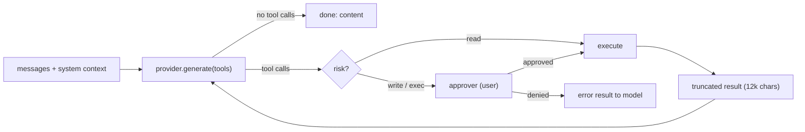

# Agent Runtime & Approvals

> [!abstract] One-liner
> One bounded tool loop (`runAgentLoop`) powers the Assistant, agent chats and [workflow steps](./workflows.md). Agents can read files, write files, run commands and call MCP tools — but every side effect has a **risk level**, and `write` / `exec` calls wait for the user.

## The Loop (`lib/runtime/agent-loop.ts`)



| Limit | Value |
|-------|-------|
| Default / max turns | 25 / 100 (`settings.json` → `assistant.maxToolTurns`) |
| Tool calls per model reply | 20; duplicate name + argument calls are removed |
| Tool calls per loop | 100 |
| Context estimate | 200 000 chars; oldest complete tool exchanges are removed first |
| OpenAI-compatible output | 8 192 tokens |
| Tool timeout | 60 s default (shell up to 300 s) |
| Tool result size | 12 000 chars, then truncated |
| At a safety limit | one final model call asks for the best answer and remaining work; tool calls in that reply are not executed |

Before every provider request, the loop estimates the full request size. If needed, it removes the oldest complete assistant/tool exchange without splitting protocol pairs or removing the caller's initial messages. If protected input alone is too large, it stops with `AgentContextLimitError`. Provider requests receive the run's `AbortSignal`, so timeout and cancel also stop an in-flight HTTP request.

Events emitted include `token`, `tool_call`, `tool_result`, `approval_required`, `approval_resolved`, `turn_start`, `llm_request`, `llm_response`, `tool_limit`, and `context_compacted`. The chat streams its supported events over SSE (`lib/sse.ts`, `lib/sse-client.ts`). Workflow runs also write the full event set to their audit log.

## Tool Risk

| Risk | Meaning | Approval |
|------|---------|----------|
| `read` | no side effects | never |
| `write` | changes workspace files | asked, unless **Allow file writes** is on |
| `exec` | runs a program, a risky MCP server, or writes config dirs | asked **every time**, unless that exact call was allowed for this run |

## Built-in Tools (`lib/runtime/tools/`)

| Tool | Risk | Notes |
|------|------|-------|
| `fs_list`, `fs_read` | read | inside `resolveInWorkspace`; `.git/` not readable; read cap 100 KB |
| `fs_write` | write → exec | writes to `.cursor/`, `.claude/`, `.agents/`, `.black-agents/` escalate to exec; `.git/`, `.black-agents/brain/`, `.black-agents/runs/` are blocked |
| `shell_run` | exec | `spawn` with `shell: false`, command must match `^[\w./@+-]+$`, 20k output cap |
| `browser_run_flow` | exec | Desktop only; replays `.black-agents/browser-flows/<name>.json` via the `browser` MCP server — see [Browser Automation](../specs/browser-automation.md) |

MCP tools are named `server__tool` and get their risk from the server's **trust**, stored in `.black-agents/mcp-policy.json`:

| Trust | Risk | |
|-------|------|-|
| `trusted` | read | |
| `ask` | write | default |
| `risky` | exec | |

## Which Tools an Agent Gets

Agent frontmatter decides the toolset (see [Agents](../artifacts/agents.md)):

```yaml
tools: [fs_list, fs_read, fs_write, browser_run_flow]   # missing = fs_list + fs_read
mcpServers: [browser]                                     # missing = every workspace server
```

The generic Assistant gets read-only files (plus `fs_write`) and every MCP server. A workflow step can override both. On non-desktop runtimes, tools from the `browser` MCP server are omitted from the toolset.

## How an MCP Server Connects

Servers live in **`.black-agents/mcp.json`** (see [MCP Servers](./mcp-servers.md)). `resolveMcpTransport` (`lib/mcp/transport.ts`) picks the client:

| Transport | When | Client |
|-----------|------|--------|
| `stdio` | `command` is set, or `transport: "stdio"` | `StdioClientTransport` |
| `http` | `url` is set and the user picks HTTP, or a URL has no transport | `StreamableHTTPClientTransport` (HTTP POST) |
| `sse` | the user picks SSE | `SSEClientTransport` |

A URL with no `transport` is HTTP, not SSE. Streamable HTTP servers answer 405 to a GET, so they must not use the SSE client.

Remote servers may send headers on every request (`mcpAuthRequestInit`) after `${secret:…}` resolution. `collectMcpHeaders` (`lib/mcp/headers.ts`) builds that map from the settings form. Tokens entered in Settings are promoted into `~/.black-agents/secrets.json`; the workspace file keeps placeholders only.

Settings → MCP Servers has three choices: **stdio**, **HTTP**, and **SSE**. HTTP and SSE show a URL field and an **Add header** list (password fields). A bearer token is `Authorization` / `Bearer …`.

## The Approval Registry (`lib/runtime/approvals.ts`)

- In memory, on `globalThis` (survives dev hot reloads), keyed by request id.
- Scope is `{ kind: "chat" }` or `{ kind: "run", runId, stepId, workflow }`.
- Pending requests time out after **15 min** and resolve to **deny**.
- `GET /api/approvals` lists them; `POST /api/approvals/[id]` decides `{ approved, remember? }`. `remember` is honored only for `exec`.
- Non-streaming callers (JSON-mode `/api/chat`) use `denyAllApprover`: gated calls are denied with a reason the model can read.

> [!warning] Safety posture
> Model output stays untrusted. Tool arguments are zod-checked by each tool; file paths never leave the workspace; secrets never reach tools. The `llm-output-safety` rule describes this model.

## Related

- [MCP Servers](./mcp-servers.md) — config path, secrets, trust file
- [Browser Automation](../specs/browser-automation.md) — Playwright MCP + `browser_run_flow`
- [LLM Integration](./llm-integration.md) — providers, protocols, system context
- [Workflows](./workflows.md) — runs use run-scoped approvals
- [Jev Decision Engine](./jev-decision-engine.md) — picks which artifacts the loop sees
- [API Reference](../api/api-reference.md) — `/api/chat` (SSE), `/api/approvals`, `/api/mcp`, `/api/browser`
- [Workspace & Filesystem Safety](./workspace-filesystem-safety.md)
