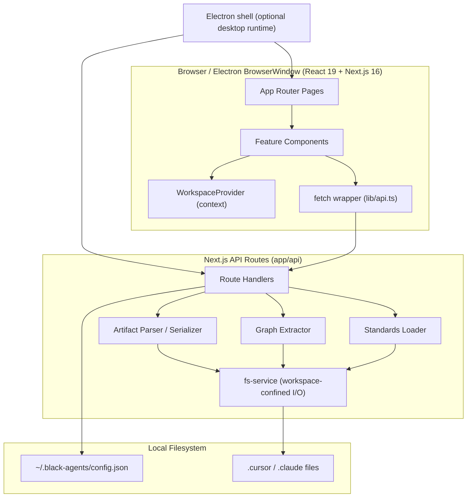

# Architecture Overview

## System Diagram

## Architectural Layers

### 0. Optional Desktop Shell (`electron/`)
- Starts the Next.js standalone server on an available loopback port.
- Hosts the existing UI in a sandboxed `BrowserWindow`; no separate desktop UI or IPC API.
- Packages the application for macOS, Windows, and Linux.
- See [Electron Desktop](./electron-desktop.md).

### 1. Presentation (`app/`, `components/`)
- App Router pages define routes per artifact type.
- `components/features/*` holds module UI (dashboard, editor, wizard, graph).
- `components/ui/*` are shadcn/Radix primitives; `components/layout/*` is the shell.
- `WorkspaceProvider` shares the active workspace across the tree.

### 2. API Layer (`app/api/`)
- Route handlers are the **only** code that touches the filesystem.
- Every response uses a consistent envelope: `{ success, data }` or `{ success: false, error }` (`lib/api-response.ts`).
- See [API Reference](../api/api-reference.md) for every route.

### 3. Domain Layer (`lib/artifacts/`)
- **types** — the platform-agnostic [Domain Model](./domain-model.md).
- **layout** — per-platform directory/extension/nesting map.
- **parser** — scan a workspace into `Artifact[]`.
- **serializer** — turn an input back into file content + path.
- **graph** — extract cross-references into nodes + links.
- **schemas / constants** — Zod validation + UI metadata.

### 4. Filesystem Boundary (`lib/fs-service.ts`)
- Resolves and guards every path against the workspace root.
- See [Workspace & Filesystem Safety](./workspace-filesystem-safety.md).

### 5. LLM Layer (`lib/llm/`, `lib/secrets.ts`)
- A swappable provider contract, server-only credentials, and fenced-JSON protocols behind the assistant routes.
- Model output is untrusted until validated. Chat streams over SSE.
- See [LLM Integration](./llm-integration.md).

### 6. Agent Runtime (`lib/runtime/`, `lib/assistant/`, `lib/mcp/`)
- A bounded multi-turn tool loop with built-in file/shell tools and MCP tools.
- Every `write` / `exec` call waits for user approval.
- See [Agent Runtime & Approvals](./agent-runtime-approvals.md).

### 7. Decision Layer (`lib/decision/`)
- Optional [Jev](./jev-decision-engine.md) classifiers for routing, step gates, schedule preflight, learning, skill suggest, and skill trigger checks. Chat, workflows, and learning fail open. The two skill checks return 412 when Jev is off.

### 8. Workflows & Brain (`lib/workflows/`, `lib/brain/`)
- An in-process runner (booted by `instrumentation.ts`) runs agent teams step by step — see [Workflows](./workflows.md).
- Feedback and self-assessment create reviewable proposals — see [Second Brain](./second-brain.md).
- Workspace data lives in `.black-agents/` (`workflows/`, `runs/`, `brain/`, `mcp-policy.json`).

## Key Patterns

### Platform-agnostic core, thin adapters
The model never stores `.cursor`-specific paths. `lib/artifacts/layout.ts` maps a `(platform, type)` pair to a concrete location, so export to `.claude` / `.windsurf` is a thin adapter — see [Future Phases](../roadmap/future-phases.md).

### API-mediated I/O
The client never reads the disk directly. All reads and writes go through `/api`, keeping path-safety logic server-side.

### Server reads, client mutates via fetch
Pages fetch through `lib/api.ts`; mutations POST/PUT/DELETE to the same routes and then refetch.

## Route → Page Mapping

| Route | Page File | Purpose |
|-------|-----------|---------|
| `/` | `app/page.tsx` | Dashboard + counts |
| `/agents` `/commands` `/rules` `/skills` | `app/<type>/page.tsx` | Typed lists |
| `/<type>/new` | `app/<type>/new/page.tsx` | Create form |
| `/<type>/[name]` | `app/<type>/[name]/page.tsx` | Edit form |
| `/new` | `app/new/page.tsx` | Guided wizard |
| `/graph` | `app/graph/page.tsx` | Relationship graph |
| `/standards` | `app/standards/page.tsx` | Standards editor |
| `/export` | `app/export/page.tsx` | Multi-platform export (diff + write, cross-repo, `.zip`) |
| `/sync` | `app/sync/page.tsx` | Per-platform drift report |
| `/settings` | `app/settings/page.tsx` | Workspaces, AI, MCP servers/trust, Browser (desktop) |
| `/chat` | `app/chat/page.tsx` | Assistant (tools, approvals, bundles, feedback) |
| `/workflows` | `app/workflows/page.tsx` | Workflow list + waiting approvals |
| `/workflows/new`, `/workflows/[name]` | `app/workflows/…/page.tsx` | Workflow builder |
| `/workflows/runs/[id]` | `app/workflows/runs/[id]/page.tsx` | Live run view |
| `/brain` | `app/brain/page.tsx` | Brain inbox, memory, history |

## Related

- [Domain Model](./domain-model.md)
- [Workspace & Filesystem Safety](./workspace-filesystem-safety.md)
- [Relationship Graph](./relationship-graph.md)
- [LLM Integration](./llm-integration.md)
- [Agent Runtime & Approvals](./agent-runtime-approvals.md) · [MCP Servers](./mcp-servers.md) · [Jev Decision Engine](./jev-decision-engine.md) · [Workflows](./workflows.md) · [Second Brain](./second-brain.md)
- [Electron Desktop](./electron-desktop.md) · [Browser Automation](../specs/browser-automation.md)
- [API Reference](../api/api-reference.md)
