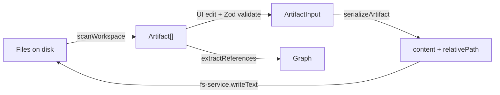

# Domain Model

The domain model is **platform-agnostic**. It describes what an artifact *is*, never where a specific tool stores it. That mapping lives separately in `lib/artifacts/layout.ts`.

## Core Types (`lib/artifacts/types.ts`)

```ts
type ArtifactType = "agent" | "command" | "rule" | "skill"
type Platform = "cursor" | "claude" | "windsurf"

interface Artifact {
  type: ArtifactType
  name: string                 // kebab-case identifier
  platform: Platform           // where it was found
  frontmatter: ArtifactFrontmatter
  body: string                 // Markdown after frontmatter
  relativePath: string         // path within the workspace
}

interface ArtifactFrontmatter {
  name?: string
  description?: string
  // type-specific extras:
  parallel?: boolean           // agents
  alwaysApply?: boolean         // rules
  globs?: string[]              // rules
  [key: string]: unknown
}
```

## How Type Maps to Disk (`lib/artifacts/layout.ts`)

`PLATFORM_LAYOUTS[platform][type]` resolves the directory, extension, and nesting.

| Type | Cursor location | Extension | Nested? |
|------|-----------------|-----------|---------|
| agent | `.cursor/agents/` | `.md` | no |
| command | `.cursor/commands/` | `.md` | no |
| rule | `.cursor/rules/` | `.mdc` | no |
| skill | `.cursor/skills/<name>/` | `SKILL.md` | yes (folder) |

> [!important] Source of truth
> Those Cursor paths are the **export** layout. The files BlackAgents edits live in `.black-agents/artifacts/` (`agents/`, `commands/`, `rules/*.md`, `skills/<name>/SKILL.md`). Rules are `.md` in the source and become `.mdc` only when exported to Cursor. `managed: true` means the source copy. `scanWorkspace` prefers the source, then Cursor, then Claude. A file found only in an IDE folder is `managed: false` until Sync moves it in. See [Future Phases](../roadmap/future-phases.md).

> [!note] Why skills nest
> A skill is a *package*: its `SKILL.md` plus supporting files (scripts, references). The folder is the unit, so delete removes the directory, not just one file.

## Lifecycle of an Artifact



1. **Parse** — `parser.ts` reads `.black-agents/artifacts/` first, then IDE folders. Frontmatter uses `gray-matter`.
2. **Validate** — `schemas.ts` enforces kebab-case names and normalizes type-specific extras.
3. **Serialize** — `serializer.ts` rebuilds the file (frontmatter order matters; rules omit `name`) and returns the target path.
4. **Persist** — the route writes through `fs-service.ts`.

## Frontmatter by Type (summary)

| Type | Required | Optional extras |
|------|----------|-----------------|
| [Agents](../artifacts/agents.md) | `name`, `description` | `parallel` |
| [Commands](../artifacts/commands.md) | `name`, `description` | — |
| [Rules](../artifacts/rules.md) | `description` (no `name`) | `alwaysApply`, `globs` |
| [Skills](../artifacts/skills.md) | `name`, `description` | — |

## Related

- [Artifact Types Overview](../artifacts/artifact-types-overview.md)
- [Authoring Standards](../artifacts/authoring-standards.md)
- [Relationship Graph](./relationship-graph.md)
- [Workspace & Filesystem Safety](./workspace-filesystem-safety.md)
- [Knowledge (OKF)](./knowledge-okf.md) — facts, not artifacts
