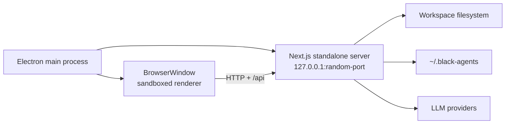

# Electron Desktop

> [!abstract] Summary
> BlackAgents can run as a native desktop application without rewriting the
> Next.js UI or API layer. Electron provides the window and lifecycle, while
> the packaged application starts the existing Next.js standalone server on a
> private loopback port.

## Why the Desktop App Still Runs a Server

BlackAgents is not a static frontend. Its API routes read and write workspace
files, load authoring standards, store local configuration, and call LLM
providers. Those capabilities require the Next.js Node runtime.

Electron therefore wraps the complete application:



This preserves the same [layered architecture](./architecture-overview.md) used by
the browser version. UI components still use `lib/api.ts`; route handlers still
own filesystem access; there is no duplicate IPC implementation.

## Runtime Lifecycle

The production lifecycle is implemented in `electron/main.cjs`:

1. Electron obtains the single-instance lock.
2. It asks the OS for an available loopback port.
3. It starts `resources/server/server.js` with `utilityProcess.fork`. That helper
   stays out of the Dock. A normal spawn of the Electron binary shows the Next
   server as a second Dock icon.
4. It waits until the local HTTP server responds.
5. It opens a `BrowserWindow` at the generated `http://127.0.0.1:<port>` URL.
6. Quitting the application terminates the child server process. On macOS,
   closing the last window keeps the app and server available until Quit.

The server port is intentionally dynamic, so an existing BlackAgents dev
server or another local service does not block startup.

`electron/server-utils.cjs` contains the independently tested port allocation,
server readiness, and external-URL validation helpers. `electron-log` records
main-process startup failures and unexpected server exits.

## Development Mode

```bash
npm run desktop:dev
```

Development mode starts the regular Next.js dev server at
`http://127.0.0.1:3000` with **`BLACK_AGENTS_DESKTOP=1`**, waits for it, and
opens Electron with `ELECTRON_START_URL` pointing to that server (same env flag
on the Electron process). The packaged app sets `BLACK_AGENTS_DESKTOP=1` on the
forked Next utility process in `electron/main.cjs`.

That flag gates [Browser Automation](../specs/browser-automation.md) (`lib/browser/platform.ts`). Plain
`npm run dev` does **not** enable browser MCP tools.

Chromium for Playwright MCP (once per machine):

```bash
npm run desktop:install-browser
```

> [!tip] Source changes during development
> Next.js hot reload applies UI and server changes automatically. Restart
> `desktop:dev` only when changing the Electron main process or its dependencies.

## Production Build and Packaging

`next.config.mjs` sets:

```js
output: "standalone"
```

The standalone build contains the minimum Node server and traced runtime
dependencies. `electron-builder` packages these resources:

| Source | Packaged destination |
|--------|----------------------|
| `.next/standalone` | `resources/server` |
| `.next/standalone/node_modules` | `resources/server/node_modules` |
| `.next/static` | `resources/server/.next/static` |
| `public` | `resources/server/public` |

The Electron shell has its own small `electron/package.json`. Keeping the shell
package separate prevents the complete frontend dependency tree from being
copied twice. The current unpacked macOS application is approximately 325 MB;
the compressed DMG/ZIP is approximately 129 MB.

The shell's runtime dependencies must be installed in `electron/node_modules`
before packaging. `npm run desktop:deps` does this, and `desktop:dev`,
`desktop:dir`, and `desktop:pack` call it automatically. Without that directory,
electron-builder silently falls back to the web app's `node_modules`, and the
installer crashes at launch with `Cannot find module 'electron-log/main'`.
`electron/verify-packaged-deps.cjs` (the `afterPack` hook) inspects the generated
`app.asar` and fails the build when a declared shell dependency is missing.

### Build commands

```bash
# Unpacked app for local verification
npm run desktop:dir

# Installer/archive for the current operating system
npm run desktop:pack
```

Generated files are placed in `dist-electron/` and are intentionally ignored
by Git. Current targets:

- macOS: DMG and ZIP
- Windows: NSIS installer
- Linux: AppImage

### Windows installer hooks

`package.json` points `build.nsis.include` at `electron/installer.nsh`. The
custom macros there solve two upgrade problems:

- `customCheckAppRunning` matches the app executable by name instead of by
  install-directory prefix. The stock template also matches helpers stored in
  `resources/`, so it claimed the app was running when no window existed, and
  users were told to close it manually.
- `customInit` deletes legacy `resources/server/dist-electron` trees that early
  packages embedded. Their paths exceed Windows `MAX_PATH`, which made the old
  uninstaller abort and blocked every upgrade.

`outputFileTracingExcludes` cannot prevent that: Next resolves the exclude globs
with `path.join`, so on Windows the pattern contains backslashes and picomatch
never matches. Instead, the `.next/standalone` `extraResources` filter in
`package.json` drops `dist-electron/**` and `.git/**` while copying, so the
installer never ships a nested build.

## How Source Changes Reach Desktop Users

| How BlackAgents is running | Are source changes automatic? |
|----------------------------|-------------------------------|
| `npm run desktop:dev` | Yes — Next.js hot reload |
| `npm run desktop:dir` output | No — rebuild the unpacked app |
| Installed DMG/installer | No — create and install a new package |

A public release does not start from a local pack. [Release Please](../devops/releases.md)
bumps the version, and GitHub Actions builds the installers. `npm run desktop:pack`
is only a local check. Automatic updates are not implemented yet. They would require:

1. signed application builds;
2. hosted release artifacts and metadata;
3. an updater such as `electron-updater`;
4. an in-app update/check/restart flow.

## Renderer Security

The desktop window uses Electron's hardened renderer defaults:

- `contextIsolation: true`
- `nodeIntegration: false`
- `sandbox: true`
- no preload bridge is currently needed
- new windows are denied
- only `http:` and `https:` external links may open in the system browser
- cross-origin top-level navigation is blocked

The renderer does **not** receive direct Node or filesystem access. It follows
the same API-mediated I/O boundary described in
[Workspace & Filesystem Safety](./workspace-filesystem-safety.md).

## Local Data

Desktop and browser modes intentionally share the same data:

| Data | Location |
|------|----------|
| Saved/active workspaces | `~/.black-agents/config.json` |
| LLM credentials | `~/.black-agents/secrets.json` |
| Assistant provider/model defaults | `~/.black-agents/secrets.json` (`defaults`) |
| Standards override | `<workspace>/.black-agents/standards.md` |
| Artifacts | `<workspace>/.cursor`, `.claude`, etc. |

Installing or upgrading the desktop executable does not replace these files.

> [!important] Why the Assistant model is not stored in localStorage alone
> Packaged Electron assigns a **new loopback port** on every launch
> (`http://127.0.0.1:<random>`). Browser `localStorage` is origin-scoped, so a
> selection saved against yesterday's port is invisible today. The Assistant
> therefore persists provider + model through `PUT /api/providers` into
> `secrets.json` defaults, which survive restarts in both browser and desktop
> modes.


## Verification

The Electron utilities have unit coverage for:

- allocating a bindable local port;
- waiting for the packaged server;
- allowing only safe external URL protocols.

The macOS ARM64 package was verified by launching the packaged `.app`, loading
the dashboard and Assistant from its random loopback server, and checking for
new browser console errors.

## Distribution Status

> [!warning] macOS signing
> The current package is unsigned. Gatekeeper may warn when another user opens
> it. Public distribution should add a Developer ID Application certificate,
> hardened runtime/entitlements as needed, and Apple notarization.

Code signing is also a prerequisite for a trustworthy automatic-update flow.

## Key Files

| File | Responsibility |
|------|----------------|
| `electron/main.cjs` | Application lifecycle, server process, secure window |
| `electron/server-utils.cjs` | Port allocation, readiness polling, URL safety |
| `electron/package.json` | Minimal desktop runtime package |
| `electron/icon.png` | Desktop application icon |
| `next.config.mjs` | Enables standalone server output |
| `package.json` | Desktop scripts and `electron-builder` targets/resources |
| `tests/unit/electron/server-utils.test.ts` | Desktop lifecycle utility tests |

## Related

- [Browser Automation](../specs/browser-automation.md) — desktop-only Playwright MCP gate
- [MCP Servers](./mcp-servers.md) — workspace MCP config under `.black-agents/`
- [Architecture Overview](./architecture-overview.md)
- [Getting Started](../overview/getting-started.md)
- [Tech Stack](../overview/tech-stack.md)
- [Workspace & Filesystem Safety](./workspace-filesystem-safety.md)
- [Testing](../overview/testing.md)
- [Releases](../devops/releases.md)
