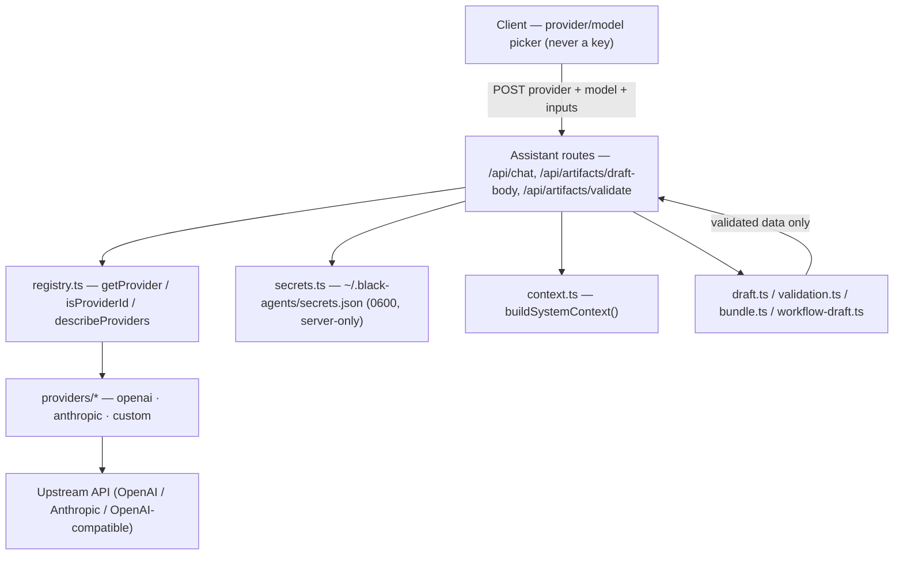

# LLM Integration

> [!abstract] One-liner
> How BlackAgents talks to language models: a small **provider contract** with swappable adapters, **server-only credentials**, a deterministic **system context**, and **fenced-JSON protocols** parsed with `zod`. Since 2026-10 the loop is **multi-turn with tools, bounded and approval-gated** — see [Agent Runtime & Approvals](./agent-runtime-approvals.md). The model proposes, the user disposes: any write or command waits for the user.

## The Layer (`lib/llm/`)



Layering rules:
- **Providers are pure I/O adapters** behind the contract — no app knowledge, no disk access.
- **Credentials are read only in route handlers** (`getProviderSecret`); they never reach `lib/artifacts/**` or the client.
- **Model output is untrusted** until `extractDraft` / `extractValidation` / `extractBundle` / `extractWorkflowDraft` validate it against a schema.

## Provider Contract (`lib/llm/types.ts`)

`LLMProvider = { id, label, models[], requiresBaseUrl?, generate(request, credentials) }`.

| Provider | Shape | System context placement |
|----------|-------|--------------------------|
| `openai` | OpenAI `/chat/completions` | prepended as a `system` message (`toOpenAIMessages`) |
| `anthropic` | Messages API | top-level `system` field; only user/assistant turns forwarded |
| `custom` | any OpenAI-compatible endpoint (Ollama, LM Studio, Groq, OpenRouter, a gateway) | as OpenAI; `requiresBaseUrl: true`, empty `models[]` |

- `generate` maps every non-2xx upstream response to `ProviderError(message, status)`; empty content is a `502`.
- `describeProviders()` exposes a **credential-free** descriptor to the client — the raw key is never in it.
- Adding a provider: implement the adapter (reuse `openAICompatibleGenerate` for OpenAI-shaped APIs), register it in `registry.ts`, and extend the `ProviderId` union.

## Credentials (`lib/secrets.ts`)

- Persisted to `~/.black-agents/secrets.json`, written mode `0600` (and re-`chmod`'d in case the file pre-existed) — a separate file from the workspace [config](./workspace-filesystem-safety.md) so config can be synced while secrets stay private.
- The [`/api/providers`](../api/api-reference.md) route returns only a redacted `ProviderStatus` (`configured` + `last4` + `baseUrl`) via `toStatusList` — the raw key never crosses the network back to the client.
- Missing credentials are a **412** (`fail("No API key configured …", 412)`), distinct from a `400` malformed body.

## System Context (`lib/llm/context.ts`)

`buildSystemContext()` assembles the persona line + the current [Authoring Standards](../artifacts/authoring-standards.md) (`loadStandards()`) + a registry of the active workspace's artifacts (`type/name: description`) + one line per [knowledge concept](./knowledge-okf.md) (id, title, description — never the body) + the workflows already saved + the protocol blocks. Standing rules go in the **system** context; the specific task goes in the **user** turn. The model reads a concept with `fs_read` at `.black-agents/knowledge/<id>.md`.

Extra sections added per turn:
- **Loaded artifacts** — chosen by mention or by [Jev](./jev-decision-engine.md) (`lib/assistant/turn-artifacts.ts`), injected as quoted JSON data.
- **Memory notes** — the agent's and workspace's [Second Brain](./second-brain.md) notes (~3k budget).

## Chat Transport (`lib/assistant/chat-service.ts`)

`/api/chat` streams **SSE** when the request has `Accept: text/event-stream`, else returns JSON (and denies any gated tool call).

| Event | Payload |
|-------|---------|
| `context` | the artifacts loaded for this turn |
| `token` | text (whole-turn chunks; no token-by-token streaming yet) |
| `tool_call` / `tool_result` | each tool call and its (truncated) result |
| `approval_required` / `approval_resolved` | a write/exec call waiting for the user |
| `memory_folding` | older messages are being summarized before the reply |
| `done` | final content, draft, bundle, `stoppedAtLimit`, and `memory` when older messages are covered |
| `error` | message |

## Long chats (`lib/chat/memory.ts`, `lib/assistant/conversation-memory.ts`)

The browser keeps the full history; the model gets a **memory** instead of the oldest messages.

- **Memory** = `{ facts, summary, covered }`. `facts` is a *case facts* block (max 40 short lines: exact names, ids, paths, numbers, decisions, open questions), kept apart from the prose `summary` so folding never blurs them. `covered` = how many leading request messages it replaces. It is stored with the conversation in localStorage and sent back on every message (zod-validated both ways; a broken one is dropped, never trusted).
- **When to fold** (`planCompaction`): once more than 24 messages, or more than `min(120k chars, half the model budget)`, are not covered yet. The newest 8+ messages always stay word for word, and the verbatim part always starts with a user message.
- **Folding** (`foldConversation`): one extra call — the **Fast** task model when it is set and verified, else the chat model — at temperature 0, with the old memory plus the next older messages as quoted data. Its reply must be one ` ```conversation-memory ` JSON block; anything else returns `null` and the turn sends the longer history instead of a broken summary.
- **Prompt**: `renderMemorySection` adds `## Conversation memory` to the system context, framed as notes (not instructions); newer messages win, and the model must say so when a detail is in neither.
- **Per-model budget** (`lib/llm/context-limits.ts`): `contextCharsFor(model)` maps model families to token windows (unknown → 64k), keeps 15% headroom plus an 8k reply reserve, and is passed as `maxContextChars` to the agent loop (replaces the fixed 200k chars for chat). A message still too large returns a clear `413`.
- **UI**: the chat shows "The first N messages are summarized…" with **View memory**; each fact can be sent to Brain Memory (an Inbox proposal, never auto-saved).

## The Protocols (the agentic contract)

The assistant may call tools during a turn, but its **final reply** is steered to a fenced JSON block that the route parses.

| Protocol | Fence | Schema / extractor | Powers |
|----------|-------|--------------------|--------|
| Draft a new artifact | ` ```artifact ` | `draftSchema` / `extractDraft` (`draft.ts`) | [[Assisted Artifact Drafting\|Draft with assistant]] + `/chat` |
| Draft a team | ` ```bundle ` | `bundleSchema` / `extractBundle` (`bundle.ts`) | `/chat` bundle card: 1 agent + ≤ 3 skills + ≤ 3 rules, checked with `checkArtifactStandards`, saved with **Create all** |
| Draft a workflow | ` ```workflow ` | `workflowSchema` / `extractWorkflowDraft` (`workflow-draft.ts`) | `/chat` workflow card: **Save** or **Open in builder**. At most one draft, bundle, or workflow block per reply |
| Review an artifact | ` ```validation ` | `validationResultSchema` / `extractValidation` (`validation.ts`) | [Validate with assistant](../specs/assisted-artifact-drafting.md) |
| Propose a learning | ` ```proposal ` | `extractProposalDraft` (`lib/brain/learn.ts`) | [Second Brain](./second-brain.md) inbox |
| Ask the user to choose | ` ```choices ` | `choicesBlockSchema` / `inspectChoices` (`choices.ts`) | `/chat` choice card (assistant and agent personas): click one (`multiple: false`) or several options, plus an **Other** free-text field. **Send answer** posts `B) text` lines and `Other: …` as the next user message. The card is live only on the latest turn |

- **Choice fallback**: a reply with no ` ```choices ` block still gets the card when it ends with options lettered `A)`, `B)`… in order (bullets, bold, `A.`, `(A)` and `A:` work; at most 3 lines may follow). Those lines move from the prose into the card. "Select all" / "all that apply" makes it multiple choice. Code blocks are ignored. The choice card is not shown when another draft card is in the reply.

- Extractors return `null` on a missing block or failed `safeParse`; callers choose a safe fallback (a `502` when no usable draft, or surfacing prose as a single `info` finding) — never a fabricated "valid" result.
- A draft `body` is **markdown only, no frontmatter** — the platform adds frontmatter on serialize/export.
- The protocol modules are **isomorphic** (no node imports) so the client and the route parse identically.
- A workflow draft is checked again with `workflowSchema` before it is saved. Every step's `agent` must already exist; the card blocks **Save** when one is missing. `checkWorkflowDraft` also shows the effective ability and warns about missing write/command tools, per-write approvals, and unrestricted MCP with automatic writes. **Ask Assistant to fix the step tools** sends those exact findings back to the model. **Open in builder** stores the draft under `black-agents:workflow-draft` in `sessionStorage` and opens `/workflows/new` (or the existing workflow when the name already exists).
- **Link detection** trusts the workspace, not the model: `detectLinks` runs the [reference extractor](./relationship-graph.md) over the real workspace plus a synthetic draft node, so a claimed link only counts if it resolves to an artifact that exists.
- **Knowledge files stay valid OKF even off-protocol**: a model with the `fs_write`/`fs_edit` tools (general chat, an agent persona, or a workflow step) could otherwise write a plain `.md` straight into `.black-agents/knowledge/`, skipping the ` ```knowledge ` draft/Inbox review entirely and leaving an invalid concept (missing `type`) that the Knowledge screen reports as broken. The tools themselves now refuse that: any `.black-agents/knowledge/**/*.md` write or edit (except the reserved `index.md`/`log.md`) is parsed with `parseConceptContent` first, and an invalid result is rejected with the exact validation error plus the expected frontmatter shape — before anything touches disk.

## Files on a message (`lib/chat/attachments.ts`)

A user message may carry up to **5** attachments (20 MB together). `toChatMessage` in `lib/assistant/chat-service.ts` splits them:

| Kind | Limit | What the model receives |
|------|-------|-------------------------|
| `text` | 200 KB | Quoted JSON under `## Attached files`. Treated as data, not instructions |
| `youtube` | 200 KB of transcript | Quoted JSON under `## YouTube videos`. Same data rule. Not a native part |
| `image` (`png`, `jpeg`, `webp`, `gif`) | 5 MB, base64 | A native image part |
| `pdf` | 10 MB, base64 | A native document part |

`isBinaryAttachment` is true only for `image` and `pdf`. `ChatMessage.attachments` holds only those. OpenAI and custom send `image_url` and `file` parts (`toOpenAIUserContent`). Anthropic sends `image` and `document` blocks (`toAnthropicUserContent`). Chat history (`lib/chat/conversation-history.ts`) keeps the name, kind, and size — and the url for a YouTube video — never the file bytes or the transcript. How a link becomes a transcript: [YouTube Sources](../specs/youtube-sources.md).

## Voice (`hooks/use-voice-input.ts`)

The send button is a microphone while the input is empty. Speech becomes text in the field; the user still sends it.

1. **Browser** — Web Speech API, live transcript, stops after about 1.6 s of silence.
2. **Cloud fallback** — when the browser has no speech engine, or the engine reports `network`. `lib/audio/wav.ts` turns the clip into 16 kHz mono WAV. `POST /api/assistant/transcribe` (`lib/llm/transcribe.ts`) uses the selected provider's verified key: OpenAI `whisper-1` (`/v1/audio/transcriptions`), or a custom OpenAI-compatible chat completion with an `input_audio` part. Anthropic has no speech API, so the route returns **412**.

**Voice model (Custom).** The server picks it, not the browser: the model saved in Settings → AI → **Models by task → Voice** (`settings.models.voice`), else `google/gemini-2.5-flash` when Custom's base URL is OpenRouter. Other custom endpoints with nothing saved get **412** "Choose a voice model in Settings → AI → Models by task". The Voice tab lists only models that take audio and give text (OpenRouter `architecture.input_modalities` / `output_modalities`, via `listModelsWithModalities`). The chat model in the Assistant header is not used for voice.

**Video model (Custom).** Same rules as voice, with `settings.models.video` and the **Video** tab (models that take video and give text). `lib/llm/watch-video.ts` sends the YouTube link as a `video_url` part; the notes reach the chat model as quoted `visualNotes` data on the `youtube` attachment. See [YouTube Sources](../specs/youtube-sources.md#watch-video).

The key stays server-side. A 401/403 marks the stored key invalid, same as chat.

## Stopping a Reply

While `/api/chat` is streaming, the Send button becomes **Stop the reply**. `chat-page.tsx` owns an `AbortController` and passes its signal to `streamPost`; aborting closes the request, and the route passes `req.signal` through the agent loop to the provider, tool execution, and approval wait.

- If no answer text arrived, the user message and attachments return to the composer.
- If text arrived, the partial assistant turn stays in history with `stopped: true` and the note **Stopped by you. This reply may be incomplete.**
- Leaving the page also aborts the active reply.

## Model Routing

`lib/llm/model-ref.ts` parses model ids, aliases, and `task:<kind>` refs. The most specific layer wins:

1. workflow step;
2. agent frontmatter;
3. workflow;
4. Assistant default.

Agents store optional `model` and `provider` frontmatter. Workflow steps may override both. A task ref (`task:vision`, `task:fast`, or `task:reasoning`) resolves to the provider/model saved under Settings → AI → **Models by task**. `voice` is a special transcription task and cannot be used as a chat ref.

Chat returns the real `{ provider, model, source, task? }` in its SSE `context` event. Workflow `StepRun` records the same fields. Missing or unverified choices fail before work starts; keys stay server-side. Full design: [Model Routing](../specs/model-routing.md).

## Security Posture

> [!warning] Two things the assistant must never do
> **Leak a key** or **act on unvalidated output.** Everything else follows from these.

- **Keys stay server-side** — in `secrets.json` and server memory only; never sent to the client, logged, or embedded in an error message.
- **No write without the user.** Drafts, bundles, workflow drafts and proposals return to the client and are saved only after the user confirms. Starting a workflow from chat shows a card; the run starts only when the user clicks **Run**. Tool writes and commands go through the [approval gate](./agent-runtime-approvals.md); brain proposals apply only after approval.
- **Output is parsed, not trusted** — every reply goes through a `zod` protocol before it is used.
- **Prompt-injection aware** — an artifact's `description`/`body` is treated as data, not instructions; standing rules live in the system context so a crafted artifact can't redirect the assistant.
- **Errors don't leak** — upstream failures map to `ProviderError` and surface via `fail(err.message, err.status)` without exposing response bodies or stack traces.

## Governing Artifacts (dogfooding)

BlackAgents ships its own `.cursor/` artifacts that encode this layer, so agents working in the repo follow it by default:

| Artifact | Type | Role |
|----------|------|------|
| `llm-integration` | skill | Reference: layer map, provider contract, protocols, the route recipe |
| `llm-integrator` | agent | Persona that builds providers, assistant routes, and protocols |
| `llm-security` | rule | Credential & provider-I/O guardrails (keys server-side, 412, redaction) |
| `llm-output-safety` | rule | Treat output as untrusted: parse via protocols, approval-gated tools, bounded loop |

These sit alongside the app's other stacks (`feature-developer` + `nextjs-app-patterns`, `tester` + `testing-patterns`, `uiux-designer` + `design-system`) and are themselves examples of the four [artifact types](../artifacts/artifact-types-overview.md) the app manages.

## Related

- [Agent Runtime & Approvals](./agent-runtime-approvals.md) — the tool loop and approval gate
- [Jev Decision Engine](./jev-decision-engine.md) — fast classifier for routing and gates
- [Workflows](./workflows.md) · [Second Brain](./second-brain.md)
- [Assisted Artifact Drafting](../specs/assisted-artifact-drafting.md) — the two in-editor features this layer powers
- [YouTube Sources](../specs/youtube-sources.md) — caption transcripts quoted into chat and into draft-body
- [API Reference](../api/api-reference.md) — `/api/chat`, `/api/artifacts/draft-body`, `/api/artifacts/validate`, `/api/providers`
- [Architecture Overview](./architecture-overview.md) — where this fits among the app layers
- [Relationship Graph](./relationship-graph.md) — the extractor link detection reuses
- [Testing](../overview/testing.md) — how the protocols and routes are covered
- [Authoring Standards](../artifacts/authoring-standards.md) — injected as system context
