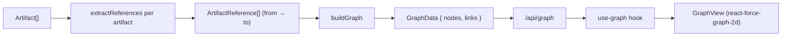

# Relationship Graph

The graph answers one question: **which artifacts reference which?** It mirrors the Obsidian graph view, but the edges come from the same authoring conventions the [Authoring Standards](../artifacts/authoring-standards.md) enforce.

## How References Are Extracted (`lib/artifacts/graph.ts`)

`extractReferences(artifact, registry)` scans an artifact's body for known patterns, then resolves each match against the registry of real artifact names.

| Pattern | Example | Resolves to |
|---------|---------|-------------|
| Bold name | `**review-code**` | an agent |
| Backtick + "rule(s)" | `` `branch-strategy` rule `` | a rule |
| Backtick + "skill(s)" | `` `jira-workflow` skill `` | a skill |
| `Related rules:` line | `Related rules: tdd, nestjs` | rules |
| `See also:` line | `See also: jira-workflow` | any type |

> [!note] Resolve, don't guess
> A token only becomes an edge if it matches an artifact that actually exists in the workspace. Names shared across types are disambiguated by the surrounding keyword (`rule` vs `skill`).

> [!tip] Edges usually start as `@`-mentions
> Authors rarely type these conventions by hand. The editor's [`@` autocomplete](../specs/artifact-mentions.md) inserts a type-qualified token (`@skill:code-review`) that is rewritten on save into exactly the inline forms above (`` `code-review` skill ``) — so a picked mention becomes a graph edge to the correct node, even when a rule and skill share a name.

## Building the Graph

`buildGraph(artifacts, concepts)` produces:
- **nodes** — one per artifact, plus one `concept:<id>` node for each knowledge concept (`type: "concept"`).
- **links** — the mention edges above, plus markdown links between concepts (`concept-concept`), concept bodies that name an agent/rule/skill (`concept-artifact`), and artifact bodies that link to a concept file (`artifact-concept`).

## Visualization (`components/features/graph/graph-view.tsx`)

- Rendered with `react-force-graph-2d` (dynamic import — canvas needs the browser).
- Node **color** = artifact type (CSS vars `--type-agent/command/rule/skill`).
- Node **size** = degree (more connected = bigger).
- Hover highlights a node's neighborhood; click opens an artifact's editor. A knowledge node does not navigate.
- The legend includes **Knowledge**. Its color uses `--primary`.
- A legend doubles as a per-type filter; a `ResizeObserver` keeps the canvas sized to its container.

> [!example] Real numbers
> Against `edu-sidekick`: 93 nodes, 198 edges. Commands sit at the hub (they wire agents), skills cluster around the rules they cite.

## Related

- [Authoring Standards](../artifacts/authoring-standards.md)
- [Artifact Mentions](../specs/artifact-mentions.md)
- [Domain Model](./domain-model.md)
- [UI Overview](../ui/ui-overview.md)
- [Knowledge (OKF)](./knowledge-okf.md)
- [API Reference](../api/api-reference.md)
