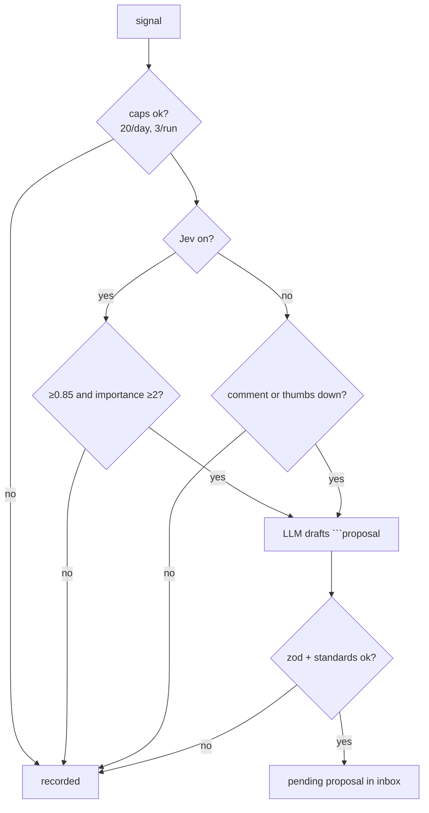

# Second Brain

> [!abstract] One-liner
> Agents learn from **user feedback** and **self-assessment**. Each learning becomes a **proposal** in a review inbox; nothing changes until the user approves it. Each agent has its own brain, and together with the shared notes they form the workspace brain.

## Files (`.black-agents/brain/`)

| File | Content | Git |
|------|---------|-----|
| `inbox/<id>.json` | proposals (pending / approved / rejected) | ignored |
| `agents/<agent>.md` | one agent's approved notes (~8k cap, oldest dropped) | committed |
| `workspace.md` | shared notes | committed |
| `log.jsonl` | every recorded / proposed / applied / rejected event | — |

Notes are one line each: `- [YYYY-MM-DD] text`. You can edit the files by hand.

## Signals

- **Feedback**: thumbs up/down + comment under chat replies and finished runs (`POST /api/brain/feedback`).
- **Self**: a workflow with `selfAssess: true` sends each finished step after the run.
- **Review**: in a `selfAssess` workflow, a step with `review: true` that ends with `VERDICT: reject` sends thumbs-down feedback (its reasons as the comment) to each agent whose work it received. It is explicit feedback, so it works without Jev, and it goes before the self signals (3/run cap). The draft prompt prefers fixing that agent's skills or rules. This is separate from `onReject`, which re-runs a fix step in the same run ([Workflows](./workflows.md)).

## From Signal to Proposal (`lib/brain/learn.ts` → `processSignal`)



- Self signals need Jev; without Jev only explicit feedback is drafted.
- The draft is a fenced ` ```proposal ` JSON block, checked with zod and `checkArtifactStandards` (e.g. skills need `## When to Apply`; rules ≤ 40 lines).
- Jev proposal kinds: `memory_note`, `update_skill`, `new_skill`, `update_rule`, `new_rule`.
- Inbox-only kinds (Jev does not draft these): `new_concept`, `update_concept`, `reverify_concept`. The OKF audit workflow creates re-verification requests through the narrow `brain_propose_reverification` tool. See [Knowledge (OKF)](./knowledge-okf.md).
- The result is `{ kind: "recorded", reason }` or `{ kind: "proposed", proposalId }`.

## Approve / Reject (`decideProposal`)

- `memory_note` → appended to the agent's brain (or `workspace.md`).
- Skill/rule kinds → saved through the artifact store (source in `.black-agents/artifacts/`, then export). Existing rule frontmatter (`alwaysApply`, `globs`) is kept. Checked again against the standards.
- `new_concept` / `update_concept` → `writeConcept` into `.black-agents/knowledge/`. Approval appends `verified`. It does not invent `generated`. Standards errors block the save; a broken concept link is only a warning.
- `reverify_concept` → keeps the latest concept body and frontmatter unchanged, then appends `{ by: "human:local", at }` to `verified`. Pending duplicates for the same concept are reused.
- The user may edit the content and description before approving.
- Already decided → 409; missing → 404.

## Using the Brain (`lib/brain/context.ts`)

Agent chats and workflow steps get a "## Memory notes" section (budget ~3k chars): the agent's notes + workspace notes. When they don't fit, [Jev](./jev-decision-engine.md) keeps the notes relevant to the task; without Jev, the newest notes that fit.

## Promote a note

On the Memory tab, **Save as knowledge** queues the note (`POST /api/brain/promote`). The note stays in Memory. Approve the inbox item to write the concept. The same id later becomes `update_concept`.

## UI — `/brain`

Tabs: **Inbox** (edit, approve, reject), **Memory** (notes + Save as knowledge), **Knowledge** (preview an OKF folder, add a concept to the inbox), **History**.

## Related

- [Knowledge (OKF)](./knowledge-okf.md)
- [Jev Decision Engine](./jev-decision-engine.md)
- [Workflows](./workflows.md) — self-assessment hook
- [Authoring Standards](../artifacts/authoring-standards.md) — skill and rule proposals must pass them
- [API Reference](../api/api-reference.md) — `/api/brain`
