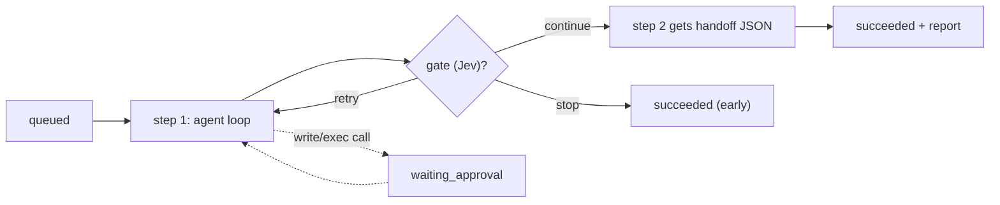

# Workflows

> [!abstract] One-liner
> A workflow is a **local agent team that works like a production line**: each step runs one workspace agent, and its result wakes the next step. No webhooks — an in-process runner does the work while the app is open.

## Files

| What | Where | Git |
|------|-------|-----|
| Definitions | `.black-agents/workflows/<name>.workflow.json` | committed (shareable) |
| Runs | `.black-agents/runs/<id>.json` (max 200, oldest pruned) | ignored |
| Audit log | `.black-agents/runs/<id>.events.jsonl` (pruned with the run) | ignored |
| Schedule state | `.black-agents/runs/.schedule-state.json` | ignored |

`.black-agents/.gitignore` is written automatically with `runs/` and `brain/inbox/`.

## Definition (`lib/workflows/schema.ts`)

```jsonc
{
  "name": "review-line",
  "task": "Default task text",
  "provider": "openai", "model": "gpt-4o-mini",   // optional
  "trigger": { "type": "manual" },                 // or interval (5–1440 min) / daily "HH:MM"
  "steps": [                                       // 1–10
    { "id": "plan", "agent": "planner", "instructions": "",
      "input": "previous",                         // previous | all | task
      "tools": ["fs_read"], "mcpServers": [],      // omit = agent's servers; [] = none
      "provider": "anthropic", "model": "claude-sonnet-4-20250514", // optional
      "allowWrites": false, "maxTurns": 6, "gate": true,
      "review": false,                             // true = ends with VERDICT: approve|reject
      "repair": false,                             // true = skipped until a review sends work here
      "onReject": { "step": "fix", "maxRounds": 2 } } // review only; 1–3 fix rounds
  ],
  "limits": { "stepTimeoutMinutes": 10, "runTimeoutMinutes": 60, "maxRetries": 1 },
  "selfAssess": false
}
```

## How a Run Works



- **Executor** (`executor.ts`): each step gets the agent persona + its linked artifacts + its [brain notes](./second-brain.md) as system context, and a message from `buildStepMessage`.
- **Handoff** (`handoff.ts`): earlier output is passed as **untrusted JSON** `{ fromStep, agent, output, filesChanged }`, never as instructions. `filesChanged` comes from successful `fs_write` calls.
- **Approvals**: the run moves to `waiting_approval` with `pendingApproval` set; the user decides on the run page or in the list's panel ([Agent Runtime & Approvals](./agent-runtime-approvals.md)).
- **Gate**: Jev's `retry` repeats the step up to `maxRetries`; `stop` skips the rest. Low confidence = continue.
- **Review** (`review.ts`): a `review: true` step must end with `VERDICT: approve` or `VERDICT: reject`. `PASS` counts as approve. `FAIL` counts as reject. The executor stores `StepRun.verdict`. With `selfAssess`, a reject is also feedback for the reviewed agents ([Second Brain](./second-brain.md)).
- **Send back** (`onReject`): only on a review step. On reject, the named step runs again with the defects quoted as untrusted JSON (`## Review feedback` in `buildStepMessage`), then this review runs again. `maxRounds` is 1–3 (how many fix passes). When the rounds run out, the run **fails**. `StepRun.sentBack` is how many times this review sent the work back. A step with `repair: true` is skipped until a review names it; it cannot also be a review, and some review must point at it.
- **Live activity** (`lib/workflows/live.ts`): while a step runs, the run snapshot carries `activity` (waiting for the model, running a tool, or waiting for approval), `turn` / `maxTurns`, `lastActivityAt`, and the last few `recent` lines. Tool traces are pushed as each call finishes. Saves are throttled to about once a second. No activity for 90 seconds shows a stuck warning on the run page.
- **Audit** (`lib/workflows/audit.ts`): every model exchange, tool call, approval, login pause, retry, gate, send-back, and error is appended as one JSON line. Secrets are redacted before write. Payloads are capped. The full prompt stays in the audit file, not in the SSE snapshot.
- **Knowledge re-verification**: `okf-staleness-check` can call only read tools plus `brain_propose_reverification`. The narrow write tool adds a pending `reverify_concept` item to the workspace Brain inbox and cannot edit knowledge. Human approval records the verification.
- **Limits**: step and run timeouts (`AbortSignal.timeout`), user cancel, at most 20 tool calls from one model reply and `maxTurns * 5` per step. Duplicate calls in one reply are ignored. OpenAI-compatible output is capped at 8 192 tokens. Before each request, old complete tool exchanges are removed when the estimated context exceeds 200 000 characters; the timeline records `tool_limit` and `context_compacted` events.
- **Never half-finished**: if a step hits its turn/tool-call safety limit, it gets one continuation round with a fresh budget before the executor accepts its output. A second safety-limit stop in the same attempt fails the run (`continuation` audit event) — see [Agent Runtime & Approvals](./agent-runtime-approvals.md#a-workflow-step-never-moves-on-half-finished).
- **LLM choice** (`llm.ts`): resolved for each step in this order: step → agent frontmatter → workflow → Assistant default → first verified provider. A layer may use `model: "task:vision"` (or `fast` / `reasoning`) to follow Settings → AI → Models by task. Credentials are cached by the final provider + model.
- **Fail fast**: manual and scheduled runs check every step before queueing. A missing task model or unverified provider returns/records a clear error.
- Run statuses: `queued`, `running`, `waiting_approval`, `succeeded`, `failed`, `cancelled`.

## The Runner (`runner.ts`)

- A `globalThis` singleton, started from `instrumentation.ts` (`register()`, Node runtime only; disable with `BLACK_AGENTS_DISABLE_RUNNER`).
- One queue **per workflow** — one run at a time.
- On start, runs left unfinished are marked failed: "Interrupted: BlackAgents restarted…".
- A tick every **60 s** starts due `interval` / `daily` workflows. Before a scheduled run, [Jev preflight](./jev-decision-engine.md) may skip it when it is very sure nothing changed (it sees recently changed files).
- After a run, the `selfAssess` hook sends each step to the [Second Brain](./second-brain.md).
- Live updates: `subscribe()` feeds the SSE route `/api/runs/[id]/events` (`run` snapshots). A `ping` every 15 seconds carries `serverTime` so the page can tell a live connection from a stuck one.

> [!note] Local only
> Scheduled runs happen only while BlackAgents is running. There is no background service.

## From the Assistant

The chat can draft a workflow and start one. See [LLM Integration](./llm-integration.md) for the ` ```workflow ` fence.

| What the user types | What happens |
|---------------------|--------------|
| A normal request for a workflow | The model emits one ` ```workflow ` block. `extractWorkflowDraft` (`lib/llm/workflow-draft.ts`) checks it with `workflowSchema`. The card shows each step's effective ability, warns when it cannot do its stated job, and offers **Save**, **Open in builder**, or **Ask Assistant to fix the step tools** |
| `/<name> <input>` at the start of the message | No model call. A run card appears |
| `start @<name> <input>`, `start @workflow:<name> <input>`, or `@workflow:<name> <input>` | Same run card |

`checkWorkflowDraft` (`lib/workflows/draft-check.ts`) compares each step's instructions with its effective tools. It catches write work with read-only tools, test/command work without `shell_run`, writes that would ask on every call, and `allowWrites` combined with unrestricted MCP access. The workflow-architect guidance requires explicit `tools`, `mcpServers`, and `allowWrites` on every generated step: read-only for planning/review, read-write for implementation, and full tools for tests or commands. MCP defaults to `[]` unless an outside service is required.

`parseWorkflowInvocation` (`lib/workflows/invocation.ts`) only matches a name that already exists, and only when the message **starts** with the pattern. `/name` in the middle of a sentence still loads an artifact ([turn artifacts](./jev-decision-engine.md)).

The card's task field starts with the typed input, or the workflow's default `task` when the input is empty. **Run** calls `POST /api/workflows/[name]/runs` with `{ task }` and links to `/workflows/runs/[id]`. The turn is stored with `workflowRun` and is left out of later `/api/chat` messages.

The `@` menu lists workflows as their own group and inserts `@workflow:<name>`.

## UI

| Page | What it does |
|------|--------------|
| `/workflows` | list (steps, trigger, last run, Run button) + **Waiting for your approval** panel |
| `/workflows/new`, `/workflows/[name]` | builder: steps (agent, instructions, input, tools, writes, turn limit, Jev gate, review send-back, fix-only step, per-step model/task kind, reorder), trigger, workflow provider/model, limits, self-assessment, run history, delete. A chat draft in `sessionStorage` (`black-agents:workflow-draft`) prefills a new builder, or an edit of the same name |
| `/workflows/runs/[id]` | **Steps** tab: live status, connection (Live / Reconnecting), elapsed time, turn counter, current action, stuck warning, approvals, outputs, files changed, tool traces, cancel, feedback. **Timeline** tab: audit events in pages of 50, with filters (AI, tools, approvals, errors, lifecycle) and JSON export |

## Related

- [Agent Runtime & Approvals](./agent-runtime-approvals.md)
- [Jev Decision Engine](./jev-decision-engine.md)
- [Second Brain](./second-brain.md)
- [API Reference](../api/api-reference.md) — `/api/workflows`, `/api/runs`
