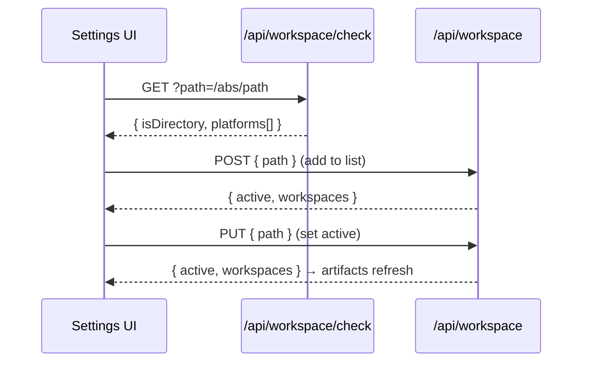

# Workspace & Filesystem Safety

A **workspace** is a project folder on disk that BlackAgents reads and writes. The app keeps an explicit **list of saved workspaces** and tracks which one is **active**; all artifact I/O targets the active workspace and is confined to it.

## App Config (`lib/config.ts`)

App-level state lives outside any workspace, at `~/.black-agents/config.json`:

```jsonc
{
  "currentPath": "/Users/me/Dev/edu-sidekick",   // the ACTIVE workspace
  "workspaces": [                                  // all SAVED workspaces
    "/Users/me/Dev/edu-sidekick",
    "/Users/me/Dev/another-project"
  ]
}
```

> [!info] Why JSON
> A single human-readable JSON file is the right fit for a local-first tool: portable, no database, trivially editable, and easy to migrate. `currentPath` keeps its name (rather than `activePath`) so the rest of the server — `fs-service` and the artifacts/graph/export routes — needs no changes; it always means "the active workspace".

Helpers:

| Function | Effect |
|----------|--------|
| `readConfig` | reads + **migrates** legacy `{ recents }` into `workspaces` |
| `writeConfig` | persists the config |
| `addWorkspace(path)` | adds to the list; activates it only if none is active yet |
| `setActiveWorkspace(path)` | switches the active workspace (adds it if missing) |
| `removeWorkspace(path)` | removes it; if it was active, falls back to the first remaining |

> [!note] Backward-compatible migration
> Older configs used `{ currentPath, recents }`. On read, `recents` folds into `workspaces` (deduped, active-first), so existing installs upgrade with no data loss.

## The Filesystem Guard (`lib/fs-service.ts`)

Every path is resolved relative to the workspace root and rejected if it escapes.

```ts
export function resolveInWorkspace(root: string, relativePath: string): string {
  const normalizedRoot = path.resolve(root)
  const target = path.resolve(normalizedRoot, relativePath)
  const rel = path.relative(normalizedRoot, target)
  if (rel.startsWith("..") || path.isAbsolute(rel)) {
    throw new WorkspaceError(`Path escapes the workspace: ${relativePath}`)
  }
  return target
}
```

> [!warning] Directory-traversal defense
> All read/write/remove helpers (`readText`, `writeText`, `removePath`, `pathExists`, `listDir`, `walkFiles`) run through `resolveInWorkspace`. A crafted name like `../../etc/passwd` throws instead of escaping.

## Adding & Switching Workspaces



- **Add** — the Settings field calls `/api/workspace/check` live to confirm the path is a directory and which platforms exist, then `POST /api/workspace` adds it to the saved list. Adding does **not** hijack the active workspace (it only auto-activates if there is none yet).
- **Set active** — `PUT /api/workspace` switches the active workspace, from the Settings list or the header **workspace switcher** dropdown. Changing the active workspace re-fetches the artifact list.
- **Remove** — `DELETE /api/workspace` drops it from the list; if it was active, the active falls back to the first remaining.

> [!tip] Where you switch
> The active workspace can be changed from two places: the **Settings** "Your workspaces" list, and the **header switcher** dropdown (available on every page). See [UI Overview](../ui/ui-overview.md).

## Platform Detection

`detectPlatforms()` checks for `.cursor` and `.claude`. The parser reads `.black-agents/artifacts/` first. IDE folders are export copies, not the source. See [Domain Model](./domain-model.md).

Workspace-local folders that matter:

| Path | Role |
|------|------|
| `.black-agents/artifacts/` | Artifact source |
| `.black-agents/export.json` | Which IDE folders a save updates |
| `.black-agents/knowledge/` | OKF concepts — [Knowledge (OKF)](./knowledge-okf.md) |
| `.black-agents/brain/` | Memory and the inbox — [Second Brain](./second-brain.md) |

`POST /api/workspace` with `create: true` scaffolds a template. The crypto template also seeds knowledge. Blank and software do not.

## Related

- [Domain Model](./domain-model.md)
- [Architecture Overview](./architecture-overview.md)
- [Getting Started](../overview/getting-started.md)
- [API Reference](../api/api-reference.md)
