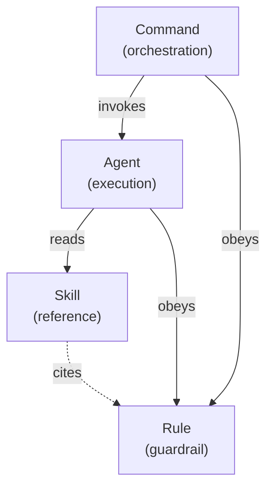

# Artifact Types Overview

BlackAgents manages four artifact types. Each has a distinct job. Choosing the right one is the single most important authoring decision — see [Authoring Standards](./authoring-standards.md).

> [!tip] One sentence
> **Commands wire, agents execute, rules constrain, skills educate.**

## At a Glance

| Type | Job | Length | Frontmatter | File |
|------|-----|--------|-------------|------|
| [Commands](./commands.md) | Orchestrate a workflow | short–medium | `name`, `description` | `commands/<name>.md` |
| [Agents](./agents.md) | Do one thing well | medium | `name`, `description`, `parallel?` | `agents/<name>.md` |
| [Rules](./rules.md) | State a constraint | very short | `description`, `alwaysApply?`, `globs?` | `rules/<name>.mdc` |
| [Skills](./skills.md) | Teach a procedure | long | `name`, `description` | `skills/<name>/SKILL.md` |

## How They Relate

- A **command** sequences agents into a workflow.
- An **agent** executes one responsibility and pulls in skills for depth.
- A **skill** is the deep how-to an agent reads when it needs detail.
- A **rule** is an always-on constraint that commands, agents, and skills respect.

## Picking the Right Type

| If the content is… | Use a… |
|--------------------|--------|
| A multi-step workflow that calls other artifacts | Command |
| A focused worker with a persona and a clear deliverable | Agent |
| A short "always do / never do" constraint | Rule |
| A detailed procedure, template, or reference | Skill |

> [!warning] Common mistakes
> Stuffing a procedure into an agent (should be a skill), writing a rule that's actually a tutorial (should be a skill), or building a command that does the work itself instead of delegating (should call agents).

## Related

- [Authoring Standards](./authoring-standards.md)
- [Domain Model](../architecture/domain-model.md)
- [Relationship Graph](../architecture/relationship-graph.md)
