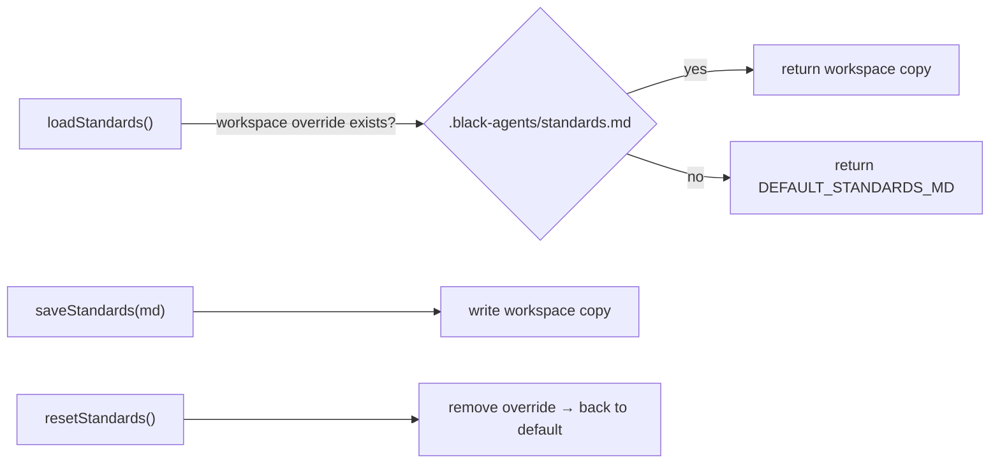
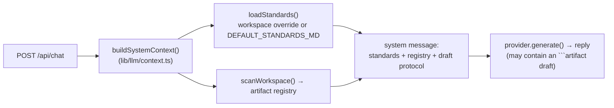

# Authoring Standards

The authoring standards are the **baseline that guides every artifact you create**. They are the generic descendant of `edu-sidekick`'s `sidekick-authoring-standards` skill, lifted out of one org and made editable per workspace.

## Two Forms

| Form | File | Used by |
|------|------|---------|
| **Structured spec** | `lib/standards/default-standards.ts` → `STANDARDS_SPEC` | editor hints + body templates |
| **Markdown doc** | `DEFAULT_STANDARDS_MD` → `<workspace>/.black-agents/standards.md` | the human-readable reference shown in the Standards editor |

`STANDARDS_SPEC` drives the in-editor guidance: required sections per type, anti-patterns to avoid, and a starter body template. The Markdown doc is the prose version a person reads.

## Loading & Overriding (`lib/standards/index.ts`)

- `loadStandards` returns the workspace override if present, otherwise the embedded default.
- `saveStandards` writes the per-workspace copy.
- `resetStandards` deletes the override, restoring the baseline.

## What the Standards Encode

- **Type selection** — commands wire, agents execute, rules constrain, skills educate.
- **Required sections** per type (e.g. an agent needs a clear responsibility + deliverable; a skill needs a "When to use" + steps).
- **Cross-reference conventions** — the bold/backtick/"Related rules:"/"See also:" patterns the [Relationship Graph](../architecture/relationship-graph.md) reads.
- **Anti-patterns** — bloated agents, tutorial-rules, do-it-all commands.

> [!tip] Standards as live context
> Because the standards are editable per workspace and surfaced in the editor via [StandardsHints](../ui/ui-overview.md), they act as the same kind of "baliza" (guardrail) Sidekick relied on — and (now shipped) as system context for the chat-based creation in [Future Phases](../roadmap/future-phases.md).

## Standards as LLM Context (chat creation)

> [!important] Creating an artifact via the chat assistant **does** use the authoring standards as context.
> Every `POST /api/chat` call injects the full standards text into the system prompt before hitting the provider, so the LLM is steered to produce artifacts that conform to the active baseline.

The flow:

- `buildSystemContext()` embeds the standards Markdown under a **`## Authoring standards`** heading, alongside the workspace artifact registry and the draft protocol.
- `loadStandards()` returns the per-workspace `.black-agents/standards.md` if present, otherwise the baked-in `DEFAULT_STANDARDS_MD` — so editing the standards changes what the LLM sees on the **next** message.
- Each provider (`lib/llm/providers/{openai,anthropic,custom}.ts`) prepends `systemContext` as a `system` message.

### Existing artifacts → connecting new ones

> [!important] The context also lists the existing artifacts, so the assistant can wire new ones to them.
> `buildSystemContext()` runs `scanWorkspace()` and injects an **`## Artifacts in the active workspace`** section. The system prompt then explicitly instructs the model to *"Follow the cross-reference conventions (reference agents/rules/skills by name)"* — so a generated artifact links into the existing toolkit instead of standing alone.

- The registry is one line per artifact: **`type/name: description`** (e.g. `agent/api-designer: Designs REST endpoints`). Falls back to a placeholder when there's no workspace or no artifacts yet.
- Those name-based references are the same patterns the [Relationship Graph](../architecture/relationship-graph.md) extractor parses, so an LLM-authored artifact shows up **connected** in the graph once saved.

> [!warning] Registry is metadata only — not full bodies
> The LLM sees each artifact's **type + name + description**, *not* its content. It can confidently reference what exists and connect by name, but it has no semantic view of each artifact's internals. (See [Future Phases](../roadmap/future-phases.md) "Still open" — loading an existing artifact's full body into chat for revision is deferred.)

> [!note] Scope: chat only
> This applies to the **chat / LLM creation path**. The manual [Wizard](../ui/ui-overview.md) and [editor](../ui/ui-overview.md) do **not** send standards to an LLM — they use the structured `STANDARDS_SPEC` for body templates and inline `StandardsHints`, then write straight to `/api/artifacts`. Standards-as-LLM-context is specific to the assistant. See [API Reference](../api/api-reference.md) (Chat) and [Future Phases](../roadmap/future-phases.md) (Phase B).

## Related

- [Artifact Types Overview](./artifact-types-overview.md)
- [Agents](./agents.md) · [Commands](./commands.md) · [Rules](./rules.md) · [Skills](./skills.md)
- [UI Overview](../ui/ui-overview.md)
- [Future Phases](../roadmap/future-phases.md)
