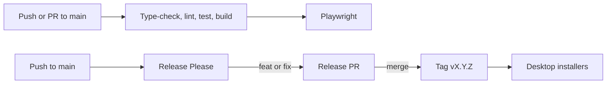

# CI/CD Pipeline



Checks do not deploy an app. The only publish steps are the [desktop installers](./releases.md) and [GitHub Pages](./github-pages.md).

## Workflow: `ci.yml`

File: `.github/workflows/ci.yml`

**Trigger:** push to `main`, and pull requests that target `main`.

**Permissions:** `contents: read`.

**Concurrency:** one run per branch. A new push cancels the older run.

### Job `validate` (`ubuntu-latest`, Node 22)

```
npm ci → npm run type-check → npm run lint → npm test → npm run build
```

The check name is **Type-Check, Lint, Test & Build**. `main` requires it.

- `type-check` is `tsc --noEmit`.
- `lint` is `eslint .`. It must be clean.
- `npm test` is Vitest unit and integration tests. See [Testing](../overview/testing.md).
- `npm run build` is the Next.js production build, including the standalone server the desktop app packages.

### Job `e2e` (needs `validate`)

```
npm ci → npx playwright install --with-deps chromium → npm run test:e2e
```

The check name is **Playwright E2E Tests**. `main` requires it.

Playwright starts its own dev server on port 3100 with `BLACK_AGENTS_CONFIG_DIR=.e2e-tmp/config`, so CI never touches a real `~/.black-agents`. On failure, `playwright-report/` is kept for 7 days.

The browser install removes leftover Google apt lists first. That avoids an apt key error on the GitHub runner.

## Branch rule: Protect main branch

| Rule | Effect |
|------|--------|
| No deletion | `main` cannot be deleted |
| No force-push | history on `main` cannot be rewritten |
| Pull request | 1 approving review before merge |
| Status checks | both CI jobs above, and they must be from the latest push |
| Copilot review | reviews on push |

Repository admins can bypass this rule. A direct push from an admin still lands on `main`, and GitHub reports that the rule was bypassed. CI still runs after that push.

## Related

- [Releases](./releases.md)
- [Testing](../overview/testing.md)
- [GitHub Pages](./github-pages.md)
