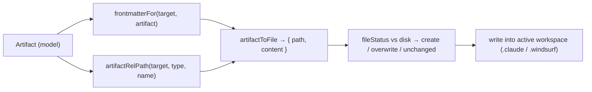
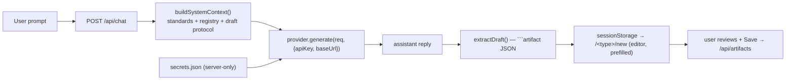

# Future Phases

v1 shipped CRUD, the [standards](../artifacts/authoring-standards.md) baseline, and the [Relationship Graph](../architecture/relationship-graph.md). Since then: **Phase A (Multi-Platform Export)**, **Phase B (Chat-Based Creation)** and **Phase C (Smarter AI)** are shipped.

## Phase A — Multi-Platform Export · shipped

The internal model is platform-agnostic ([Domain Model](../architecture/domain-model.md)), so export is a thin adapter over the layout map.

| Piece | File | Status |
|-------|------|--------|
| Adapter + frontmatter mapping | `lib/export/adapter.ts` (`frontmatterFor`, `artifactToFile`, `buildExportManifest`, `fileStatus`) | done |
| API | `GET` (manifest) + `POST /api/export` (diff + write) | done |
| UI | `/export` page — platform select, diff preview, write w/ confirm | done |
| Download | `.zip` archive of the target manifest (client-side, JSZip) | done |
| Cross-repo target | optional `targetPath` — write the bundle into another folder | done |
| Drift / sync view | `/sync` + `GET /api/drift` — per-platform in-sync / drifted / missing | done |



> [!note] The real work was frontmatter, not paths
> Re-deriving the path is trivial. The substance is `frontmatterFor(platform, artifact)`, which translates each platform's dialect:
> - **Cursor rules** keep `.mdc` + `alwaysApply` / `globs`; rules omit `name` (filename is identity).
> - **Claude** keeps `name` (agents/skills) + `description`; it has no rule-activation keys, so `alwaysApply` / `globs` / `parallel` are dropped.
> - **Windsurf** maps activation onto `trigger`: `alwaysApply` → `always_on`, `globs` → `glob` + `globs`, else `manual`; commands become **workflows**.

> [!tip] Safety + idempotency
> Writes go through the workspace-confined `fs-service` ([Workspace & Filesystem Safety](../architecture/workspace-filesystem-safety.md)). A dry-run diff (`create` / `overwrite` / `unchanged`) is shown before writing; `unchanged` files are never rewritten, and `overwrite: false` leaves changed files alone.

### `.zip` download · shipped

The Export page has a **Download .zip** button. It fetches the target manifest (`GET /api/export?platform=`), packs each `{ path, content }` into a `JSZip` archive preserving the folder layout (`.claude/...`, `.windsurf/...`), and triggers a browser download named `<workspace>-<platform>.zip` — exporting **without writing into the workspace**.

### Cross-repo target · shipped

`POST /api/export` takes an optional `targetPath`. Artifacts are always **read** from the active workspace, but the bundle is **written** into the target folder (validated as a real directory, traversal-guarded by `resolveInWorkspace` against the target root). The Export page exposes an optional "Write into" field; empty = the active workspace.

### Drift / sync view · shipped

`/sync` (powered by `GET /api/drift`) compares the canonical artifacts against what's on disk for every platform present in the workspace, reporting per-platform **in-sync / drifted / missing**.

> [!important] Semantic, not byte-exact
> Drift compares the **managed frontmatter keys + trimmed body**, ignoring formatting and extra user keys. This is the key difference from the export diff (which is byte-exact): without it, the platform an artifact was *read from* would always show as "drifted" purely because re-serialization reorders or re-quotes YAML. Export answers "what bytes will I write"; drift answers "is the meaning out of sync".

### Source of truth · shipped (2026-10-15)

Artifacts are saved in `.black-agents/artifacts/` (`lib/artifacts/source.ts`, `lib/artifacts/store.ts`). Every save also exports to the IDE folders chosen in `.black-agents/export.json` (default: IDE folders already present, otherwise Cursor). `/sync` lists drift, can **Move into BlackAgents** for IDE-only files, and can keep or overwrite a hand edit. New workspaces scaffold the source folders, not an empty `.cursor/`.

> [!warning] Old note
> "Cursor is the source of truth" is no longer true. `.cursor/` and `.claude/` are export copies. An existing workspace still shows those files as IDE-only until someone moves them on `/sync`.

### Still open (nice-to-have)

- A three-way merge when both the source and an IDE copy changed. Today you pick **Keep this change** or **Overwrite**.

## Phase B — Chat-Based Creation (BYO LLM key) · shipped

Create artifacts by describing them, with the [Authoring Standards](../artifacts/authoring-standards.md) + workspace artifact registry as system context — the same way Sidekick artifacts were authored with Cursor's LLMs.

| Piece | File | Status |
|-------|------|--------|
| Provider contract | `lib/llm/types.ts` (`ProviderId`, `ChatMessage`, `LLMGenerateRequest`, `LLMCredentials`, `LLMProvider`, `ProviderError`) | done |
| Providers + registry | `lib/llm/providers/{openai,anthropic,custom}.ts`, `lib/llm/registry.ts` | done |
| Key storage | `lib/secrets.ts` — `~/.black-agents/secrets.json` (chmod `600`), server-only | done |
| System context | `lib/llm/context.ts` — standards + registry + draft protocol | done |
| Draft protocol | `lib/llm/draft.ts` — ` ```artifact ` JSON block, zod-validated, isomorphic | done |
| API | `GET/POST/PUT/DELETE /api/providers`, `POST /api/chat` | done |
| UI | `/providers` (key management), `/chat` (thread + draft → editor) | done |



> [!important] The key never leaves the machine
> API keys live only in `~/.black-agents/secrets.json` (written `0600`). The `/api/providers` route returns a **redacted** status (`configured` + last-4) — never the raw key. `/api/chat` reads the key server-side and calls the provider from the local Next server; the browser never holds it.

> [!tip] Nothing writes to disk from chat
> The assistant proposes a draft inside a ` ```artifact ` JSON block. The chat detects it, hands it to the existing [editor](../ui/ui-overview.md) via `sessionStorage`, and the user reviews + saves through the normal `/api/artifacts` path. Generation and persistence stay separate.

The **custom** provider accepts any OpenAI-compatible base URL (Ollama, LM Studio, a gateway), so local models work with no key.

### Inline assisted drafting · shipped

Phase B's assistant now reaches **into the editor**. In the create flow, once `name` + `description` are valid and a provider is configured, **Draft with assistant** asks the LLM to write the body in place and reports which existing artifacts it linked — no round-trip through `/chat`.

| Piece | File | Status |
|-------|------|--------|
| API | `POST /api/artifacts/draft-body` | done |
| UI | `Draft with assistant` button in `ArtifactEditor` | done |
| Reuse | `buildSystemContext`, `extractDraft`, `extractReferences` | done |

It reuses the same key-stays-server-side path and draft protocol as `/api/chat`, and surfaces detected links via the [reference extractor](../architecture/relationship-graph.md). Full spec: [Assisted Artifact Drafting](../specs/assisted-artifact-drafting.md).

### Still open (nice-to-have)

- Token-by-token streaming (chat uses SSE now, but text arrives per model turn).
- Default provider/model persistence is wired in `secrets.json` (`PUT /api/providers`) but not yet surfaced in the UI.
- Extending **Draft with assistant** to the `/new` wizard and to editing existing artifacts.

> [!note] Partly done
> Loading an existing artifact into chat now works with `@type:name` / `/name` mentions (see [Jev Decision Engine](../architecture/jev-decision-engine.md)).

## Phase C — Smarter AI · shipped (2026-10)

Agents now **act**, not only draft — always with user approval. Used BlackLionFi's Jev layer as the reference.

| Piece | Where | Note |
|-------|-------|------|
| Agent runtime + approvals | `lib/runtime/` | bounded tool loop; fs + shell tools; `write`/`exec` need approval — [Agent Runtime & Approvals](../architecture/agent-runtime-approvals.md) |
| Jev decisions | `lib/decision/` | optional, fail-open — [Jev Decision Engine](../architecture/jev-decision-engine.md) |
| Skill suggest + trigger check | `lib/decision/skill-suggest.ts` | which skill fits, and whether a description is too wide — [Skills](../artifacts/skills.md) |
| MCP for agents | `lib/runtime/tools/mcp.ts`, `lib/mcp/policy.ts`, `lib/mcp/transport.ts` | `server__tool` + trust levels; stdio, HTTP POST, or SSE; optional headers — [Agent Runtime & Approvals](../architecture/agent-runtime-approvals.md) |
| Bundles | `lib/llm/bundle.ts` | 1 agent + ≤ 3 skills + ≤ 3 rules, standards-checked |
| Workflows | `lib/workflows/` | local agent teams, scheduler, live step activity, audit log, review send-back — [Workflows](../architecture/workflows.md) |
| Second Brain | `lib/brain/` | feedback → proposals → approved memory — [Second Brain](../architecture/second-brain.md) |

### Assistant files, voice, and workflows · shipped (2026-10-11)

| Piece | Where | Note |
|-------|-------|------|
| File attachments | `lib/chat/attachments.ts` | text, image, PDF on a chat message — [LLM Integration](../architecture/llm-integration.md) |
| Voice to text | `hooks/use-voice-input.ts`, `POST /api/assistant/transcribe` | mic fills the field; browser speech, then a WAV fallback |
| Workflows from chat | `lib/llm/workflow-draft.ts`, `lib/workflows/invocation.ts` | draft card, or `/<name> input` / `start @<name>` run card — [Workflows](../architecture/workflows.md) |
| Stop a reply | `components/features/chat/chat-page.tsx` | aborts model/tool/approval work; keeps partial text or restores the unsent message |
| Workflow draft safety | `lib/workflows/draft-check.ts` | checks each step has write/command tools and a narrow MCP scope before save |

### Model routing · shipped (2026-10-11)

Settings → AI → **Models by task** holds a model per job, apart from the chat model in the Assistant header. See [Model Routing](../specs/model-routing.md).

Shipped phases:

1. **Models by task** — Voice, Vision, Fast, and Reasoning.
2. **Model per agent** — [Agent Models](../specs/agent-models.md).
3. **Model per workflow step** — [Workflow Step Models](../specs/workflow-step-models.md).
4. **Model by task kind** — [Task Model Kinds](../specs/task-model-kinds.md): `model: task:vision`, `task:fast`, or `task:reasoning`.

Order when several are set — the most specific wins: **step → agent → workflow → Assistant default**. Any layer may use a task kind (`task:vision`) instead of a model id.

### YouTube sources · shipped (2026-10-13)

A YouTube link becomes a caption transcript. Chat attaches it like a file. **Skills → New** can draft the body from it and keeps a `## Sources` section. See [YouTube Sources](../specs/youtube-sources.md).

**Watch video (2026-10-20):** an opt-in switch sends the link to a **Video** task model (Gemini through OpenRouter). It adds timed notes on what the video shows, and works even when there are no captions.

### OKF knowledge · shipped (2026-10-15)

Durable facts are OKF 0.2 concepts, separate from memory notes. Full note: [Knowledge (OKF)](../architecture/knowledge-okf.md).

| Piece | Where | Note |
|-------|-------|------|
| Reader + store | `lib/knowledge/` | version pin 0.2; `writeConcept` is the knowledge writer |
| Import preview | Brain → Knowledge, `POST /api/knowledge/import` | preview writes nothing; queue only fills the inbox |
| Export | `/export` target **OKF Bundle** | `okf/index.md`, `okf/log.md`, concept files |
| Promotion | Memory → **Save as knowledge** | `generated` on the proposal; `verified` on approve |
| Assistant | `lib/llm/context.ts` | one line per concept; body via `fs_read` |
| Graph | `buildGraph(artifacts, concepts)` | concept links plus the old `@` mention edges |
| Crypto kit | `lib/workspace/crypto-knowledge.ts` | four starter concepts, not marked reviewed |

Zip import of a bundle is still deferred. Folder import is what shipped.

### Still open

- Scheduled runs work only while the app is open (no background service).
- Approvals live in memory; a restart drops pending ones (runs are marked interrupted).
- No parallel steps inside one workflow; steps run in order.
- **Project scopes are shipped for artifacts, MCP config, workflows, and knowledge** (see [Project Scopes](../architecture/project-scopes.md)). Still open: chat, the assistant context, the workflow runtime, the graph route, and the MCP settings panel do not use the active project yet.

## Guiding Principles

- Keep the filesystem boundary intact — generation and export still go through [/api](../api/api-reference.md) + fs-service.
- Standards stay the single source of "good" — they feed hints today and LLM context tomorrow.
- The model stays platform-agnostic; platform specifics live only in `layout.ts` and the export adapter.

## Reference

Full design notes live in the repo at `docs/ARCHITECTURE.md`.

## Related

- [Architecture Overview](../architecture/architecture-overview.md)
- [Domain Model](../architecture/domain-model.md)
- [Authoring Standards](../artifacts/authoring-standards.md)
- [API Reference](../api/api-reference.md)
- [Assisted Artifact Drafting](../specs/assisted-artifact-drafting.md)
- [Agent Runtime & Approvals](../architecture/agent-runtime-approvals.md) · [Workflows](../architecture/workflows.md) · [Second Brain](../architecture/second-brain.md) · [Knowledge (OKF)](../architecture/knowledge-okf.md) · [Jev Decision Engine](../architecture/jev-decision-engine.md)
