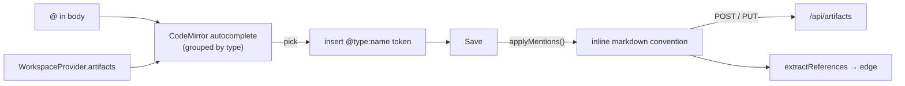

# Artifact Mentions

> [!abstract] One-liner
> Typing `@` in an artifact body opens a **type-grouped autocomplete** of every artifact in the workspace. Picking one inserts a **type-qualified token** (`@type:name`); on save the token is rewritten into the inline markdown [cross-reference convention](../architecture/relationship-graph.md), so the reference becomes a real graph edge.

## Motivation

Authors constantly link artifacts to each other, but the [cross-reference conventions](../architecture/relationship-graph.md) are easy to get wrong: was it `**name**`, `` `name` rule ``, or `` `name` skill ``? And because a rule and a skill can share a name (e.g. `design-system`), a hand-typed reference can silently point at the wrong artifact — or at one that doesn't exist, producing no edge at all.

This feature turns linking into a pick-from-a-list gesture (like `@`-mentioning a person) that is **type-aware by construction**, then formats the markdown correctly at save time.

## Requirements

- In the body editor (create **and** edit, plus the wizard's Body step), pressing `@` lists workspace artifacts to reference.
- Results are **grouped by category** — Agents / Commands / Rules / Skills — so the author never confuses an agent with a same-named skill.
- The artifact being edited never lists itself.
- On save, the picked reference is written in the correct markdown convention so the [Relationship Graph](../architecture/relationship-graph.md) detects it.

## Decisions

| Question | Decision |
|----------|----------|
| What gets inserted while typing? | A **type-qualified token** `@type:name` (e.g. `@skill:design-system`) — unambiguous even when names collide across types. |
| When does it become markdown? | On **save** (`applyMentions`), not on pick. The Preview tab renders the formatted result live so the author sees the final form. |
| Which markdown form? | The **inline** convention per target type (see below) — exactly what the graph extractor reads. |
| Where does the list come from? | The `WorkspaceProvider`'s already-loaded `artifacts` — no new fetch. |

## Design

### 1. Shared protocol — `lib/artifacts/mentions.ts`

Isomorphic (no node imports) so the editor and any route can share it.

- `mentionToken(type, name)` → `@${type}:${name}` — the token inserted on pick.
- `MENTION_TOKEN_RE` → `/@(agent|command|rule|skill):([a-z0-9]+(?:-[a-z0-9]+)*)/g`.
- `formatMention(type, name)` → the inline markdown form:

| Target type | Inserted token | Saved markdown |
|-------------|----------------|----------------|
| agent / command | `@agent:tester` | `**tester**` |
| rule | `@rule:typescript-strict` | `` `typescript-strict` rule `` |
| skill | `@skill:code-review` | `` `code-review` skill `` |

- `applyMentions(body)` → replaces every token with its markdown form. **Idempotent**: text without tokens (an already-formatted body loaded for edit) passes through unchanged.
- `hasMentionTokens(body)` → whether any unresolved token remains.

### 2. Editor autocomplete — `components/features/editor/markdown-editor.tsx`

- `MarkdownEditor` gains a `mentions: MentionItem[]` prop (`{ type, name, description }`).
- A CodeMirror `@codemirror/autocomplete` source triggers on `@`, offering each artifact as a completion whose `section` is its type (**Agents/Commands/Rules/Skills**, ranked), `displayLabel` is the name, `detail` is the description, and `apply` inserts `mentionToken(type, name)` + a trailing space.
- `label` is prefixed with `@` so fuzzy filtering aligns with the matched text; `validFor` keeps the popup open as the author narrows.

### 3. Wiring — `ArtifactEditor` and `Wizard`

- Both build `mentions` from `useWorkspace().artifacts`, **excluding the current `type + name`** so an artifact can't reference itself.
- Both call `applyMentions(body)` when building the `POST`/`PUT` payload.
- `ArtifactEditor` also renders the **Preview** tab through `applyMentions(...)`, so `@skill:design-system` shows as `design-system` (inline code) + "skill" before saving.

## Data Flow

## Why type-qualified tokens

The whole point is disambiguation. A bare `@design-system` couldn't tell the rule from the skill; `@skill:design-system` can. Because the token carries the type, `applyMentions` picks the right convention (`` `design-system` skill `` vs `` `design-system` rule ``) and the [graph](../architecture/relationship-graph.md) draws the edge to the correct node.

> [!note] Inline forms only
> Mentions insert the **inline** conventions (`**name**`, `` `name` rule ``, `` `name` skill ``). The footer-list forms (`Related rules:` / `See also:`) are structural and still authored by hand; both are detected by the extractor.

## Files

| File | Change |
|------|--------|
| `lib/artifacts/mentions.ts` | **New** — token/format/apply helpers (isomorphic) |
| `components/features/editor/markdown-editor.tsx` | `mentions` prop + `@` autocomplete grouped by type |
| `components/features/editor/artifact-editor.tsx` | Build mention list (self-excluded), `applyMentions` on save, formatted Preview |
| `components/features/wizard/wizard.tsx` | Same mention list + `applyMentions` on create |
| `package.json` | Add `@codemirror/autocomplete` (+ `@codemirror/view`/`state`) as direct deps |

## Verification

Covered by unit tests (`tests/unit/artifacts/mentions.test.ts`) and verified against the running app:

- `@` in an agent's body opened a dropdown with **Agents / Rules / Skills** sections; the agent being edited was excluded from Agents.
- A Rule and a Skill both named `design-system` appeared under their own sections.
- Picking **Skills → design-system** inserted `@skill:design-system`; the Preview rendered `design-system` (inline code) + "skill". No console errors.
- `applyMentions` is unit-tested for each type, same-name disambiguation, idempotency, and graph-detectable output.

## Chat mentions workflows

The Assistant input uses the same `@` query (`activeMentionQuery`, `mentionToken`) but adds a **Workflows** group from `GET /api/workflows`. Picking one inserts `@workflow:<name>`. That token is not rewritten by `applyMentions` (the regex is still only `agent|command|rule|skill`). Sending a message that **starts** with `@workflow:<name>`, `start @<name>`, or `/<name>` opens a run card instead of a chat turn. See [Workflows](../architecture/workflows.md).

## Open / Future

- A hover card / click-through on a mention in Preview to jump to the referenced artifact.
- Optional footer-list authoring (`Related rules:` / `See also:`) via the same picker.
- Surface broken mentions (token whose target was later deleted) in [Validate with assistant](./assisted-artifact-drafting.md).

## Related

- [Relationship Graph](../architecture/relationship-graph.md) — the conventions mentions compile to
- [UI Overview](../ui/ui-overview.md) — the editor surface
- [Authoring Standards](../artifacts/authoring-standards.md) — where the cross-reference conventions are defined
- [Assisted Artifact Drafting](./assisted-artifact-drafting.md) — the sibling in-editor assistant features
- [Testing](../overview/testing.md) — where `mentions.ts` is covered
- [Workflows](../architecture/workflows.md) — `@workflow:name` starts a run from chat
