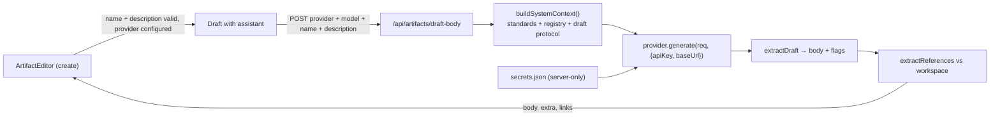
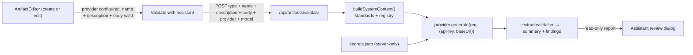

# Assisted Artifact Drafting

> [!abstract] One-liner
> Two in-editor assistant actions: **Draft with assistant** (create) writes the artifact `body` from the `name` + `description` and cross-links existing workspace artifacts; **Validate with assistant** (create + edit) reviews the current artifact against the [Authoring Standards](../artifacts/authoring-standards.md) and returns a read-only findings report.

## Motivation

Creating a good artifact from an empty [editor](../ui/ui-overview.md) is the slow part: the user knows *what* they want (a name and a one-line description) but still has to hand-write the whole body against the [Authoring Standards](../artifacts/authoring-standards.md). [Phase B](../roadmap/future-phases.md) already added a full [`/chat` assistant](../ui/ui-overview.md), but that is a separate surface — the user has to leave the editor, describe the artifact again, and round-trip a draft back.

This feature brings that assistance **inline** to the editor the user is already in: fill `name` + `description`, click one button, get a standards-shaped body with existing artifacts cross-linked, then edit freely before saving.

## Requirements

- When at least one AI provider key is configured, offer a button to draft the artifact with LLM guidance.
- The button is only available once **`name` and `description` are filled and valid** — the draft is derived from them. A **new skill** may leave the description empty when at least one YouTube video is ready ([YouTube Sources](./youtube-sources.md)).
- The assistant crafts the `body` so the user starts from a strong first draft instead of a blank page.
- The assistant should **identify existing artifacts that could be linked** to the artifact in edition.
- For **existing** artifacts, offer a **Validate with assistant** action that reviews the artifact against the standards without rewriting it — a read-only findings report.

## Decisions

| Question | Decision |
|----------|----------|
| What counts as a "working" provider? | A key is **present/configured** (or a `custom` base URL). No new live test-connection endpoint — real upstream failures surface on click. |
| Which provider/model? | **Reuse the [chat](../ui/ui-overview.md)'s last-used values** from `localStorage`, falling back to the first configured provider + its first model. |
| Where does **Draft** live? | The `ArtifactEditor` **create** flow (`/{type}/new`). The `/new` wizard is out of scope for now. |
| Overwrite existing body? | Yes — the draft replaces the current body (which is usually just the starter template). The user reviews and edits before saving. |
| What does **Validate** produce? | A **read-only findings report** (severity + message + optional suggestion). It never rewrites the body — the user edits manually. |
| Where does **Validate** live? | **Both** modes — create shows Draft + Validate; edit shows Validate. This is why the editor now loads `/api/providers` in edit mode too. |

## Design

### 1. Endpoint — `POST /api/artifacts/draft-body`

New route at `app/api/artifacts/draft-body/route.ts`, modeled on `app/api/chat/route.ts` so the **key stays server-side**.

- **Body:** `{ type, name, description, provider, model, sources? }`. `sources` is the YouTube list from [YouTube Sources](./youtube-sources.md). `description` may be empty only when `sources` is non-empty.
- **Validation:** `artifactTypeSchema`, `nameSchema` (kebab-case), non-empty `description`, `isProviderId(provider)` — all from `lib/artifacts/schemas.ts` / `lib/llm/registry.ts`. Missing-credential cases return **412** (same pattern as [`/api/chat`](../api/api-reference.md)).
- **Prompt:** reuses `buildSystemContext()` (`lib/llm/context.ts`) for standards + workspace registry + the ` ```artifact ` draft protocol, plus a focused `user` instruction to emit one draft block and reference relevant existing artifacts by name.
- **Parse:** `extractDraft()` (`lib/llm/draft.ts`) pulls `{ body, parallel, alwaysApply, globs }`; falls back to `stripDraftBlock(rawText)` if no block parses.
- **Link detection:** `scanWorkspace(currentPath)`, build a **synthetic `Artifact`** from the generated body, run `extractReferences([...existing, synthetic])` (`lib/artifacts/graph.ts`), and keep refs whose `fromName === name`.
- **Response:** `{ body, description, extra: { parallel, alwaysApply, globs }, links: { to, toName, kind }[] }`. The editor copies `description` into the form only when that field was empty. When `sources` were sent, `ensureSourcesSection` adds `## Sources` if the model left it out.

### 2. Editor UI — `components/features/editor/artifact-editor.tsx`

- On mount (**create mode only**), fetch `/api/providers` to compute `hasProvider` (a `configured` status, or a `custom` `baseUrl`).
- Resolve provider/model from the chat's `localStorage` keys (`black-agents:last-provider`, `black-agents:last-model:{provider}`) with a first-configured fallback.
- Add a `Sparkles` **Draft with assistant** button beside Save. Enabled only when `hasProvider` **and** `nameSchema` passes **and** (`description` is non-empty, or a new skill has a ready YouTube video); a tooltip explains the disabled reason.
- On click: POST to `/api/artifacts/draft-body`, then `form.setValue("body", ...)` and set `parallel` / `alwaysApply` / `globs` for the relevant type. Toast summarizes detected links (e.g. `Body drafted — linked: rule/web3-security, skill/code-review`).
- **Guard:** if no model resolves (e.g. a `custom` provider with no stored model), show an actionable toast instead of firing a request doomed to fail server-side.
- Failures surface `ApiError.message`, including the **412** "configure a key" case.

## Data Flow



## Link Detection

The endpoint does not invent a new linking mechanism — it reuses the existing [[Relationship Graph|convention-based extractor]]. The generated body is treated as a new node in the workspace graph; any reference it makes to a **real** artifact (bold agent name, `` `rule-name` `` rule, `` `skill-name` `` skill, "Related rules:", "See also:") becomes a detected link. Only edges originating from the drafted artifact are returned, so the user sees exactly what the new artifact would connect to.

> [!note] Suggestions, not writes
> Links are reported for awareness and reflected once the body is edited/saved. The graph itself is still derived from the saved body via `lib/artifacts/graph.ts` — nothing new is persisted by the draft step.

## Validate with assistant

The sibling action for **existing** artifacts (and available in create too). Where drafting *generates* a body, validation *reviews* one — non-destructively.

### Protocol — `lib/llm/validation.ts`

Mirrors the draft protocol but for findings: an isomorphic zod schema + `extractValidation()` that parses a fenced ` ```validation ` block into:

```jsonc
{
  "summary": "one-line overall assessment",
  "findings": [
    { "severity": "error" | "warning" | "info", "section": "optional aspect", "message": "what is wrong", "suggestion": "optional concrete fix" }
  ]
}
```

### Endpoint — `POST /api/artifacts/validate`

- **Body:** `{ type, name, description, body, extra?, provider, model }` — the full artifact under review.
- Reuses `buildSystemContext()` and the same server-side key path + **412** behavior as draft/chat.
- Instructs the model to review (not rewrite) against the standards, checking: missing/weak required sections, type anti-patterns, wrong type / scope creep, cross-reference correctness (must not cite artifacts that do not exist in the workspace), and description quality.
- Parses with `extractValidation()`; if the model ignores the protocol, its prose is surfaced as a single `info` finding rather than failing the request.
- **Response:** `{ summary?, findings: { severity, section?, message, suggestion? }[] }`.

### Editor UI

- A `ShieldCheck` **Validate with assistant** button, shown in **both** modes. Enabled when `hasProvider` **and** name + description are valid **and** the `body` is non-empty (there must be something to review).
- Results open in an **Assistant review** dialog: `summary` plus a severity-colored findings list (error → destructive, warning → amber, info → muted), each with its optional section and suggestion. Nothing is written — the user edits by hand.



## Files

| File | Change |
|------|--------|
| `app/api/artifacts/draft-body/route.ts` | **New** — validate input, build context, generate, parse draft, detect links |
| `app/api/artifacts/validate/route.ts` | **New** — review the artifact, return findings |
| `lib/llm/validation.ts` | **New** — findings schema + `extractValidation()` (isomorphic) |
| `components/features/editor/artifact-editor.tsx` | Provider detection (both modes), model resolution, `Draft with assistant` + `Validate with assistant` buttons, apply/report |

Reused unchanged: `lib/llm/context.ts`, `lib/llm/draft.ts`, `lib/llm/registry.ts`, `lib/secrets.ts`, `lib/artifacts/{schemas,graph,parser}.ts`.

## Verification

Verified end-to-end against the running app (custom provider → OpenRouter, `openai/gpt-4o-mini`):

- Button is **disabled** with an empty/invalid name or description, and **enables** once both are valid with a provider configured.
- Drafting an agent named `pr-guardian` returned `200` with a full standards-shaped body and `links` = `peer-reviewer` (agent), `web3-security` + `testing-required` (rules), `code-review` (skill) — all real workspace artifacts.
- The body populated into the editor and the `StandardsHints` required-section checklist was satisfied; no console errors.
- The empty-model guard correctly blocks a doomed request when no model is resolvable.

Validation verified in **edit** mode (existing `peer-reviewer` agent):

- Edit header shows Delete + **Validate with assistant** + Save (no Draft); create shows Draft + Validate, both disabled until fields are valid.
- Clicking Validate returned `200` with a `summary` + two `warning` findings (each with section, message, suggestion); the **Assistant review** dialog rendered them read-only.

## Open / Future

- Extend **Draft** to the `/new` wizard's Body step.
- A visible "linked artifacts" panel in the editor (beyond the toast).
- Assisted **revision** of an existing artifact (apply-fix from a finding, or a guided rewrite) — validation is read-only today.
- Streaming the generated body into the editor as it arrives.

## Related

- [Future Phases](../roadmap/future-phases.md) — Phase B (BYO LLM key) this builds on
- [LLM Integration](../architecture/llm-integration.md) — the provider contract, protocols, and security this rides on
- [API Reference](../api/api-reference.md) — `/api/artifacts/draft-body`, `/api/artifacts/validate`, `/api/chat`, `/api/providers`
- [UI Overview](../ui/ui-overview.md) — the editor surface
- [Relationship Graph](../architecture/relationship-graph.md) — the cross-reference conventions used for linking
- [YouTube Sources](./youtube-sources.md) — optional video transcripts on a new skill
- [Authoring Standards](../artifacts/authoring-standards.md) — what a good body looks like (and what Validate checks against)
