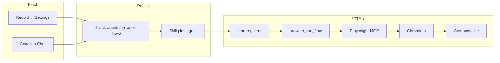

# Browser Automation

> [!abstract] One-liner
> On the **Electron desktop app**, agents drive a separate Playwright Chromium (via `@playwright/mcp`). You teach a site by **recording** or **coaching in chat**, save a flow under `.black-agents/browser-flows/`, and replay it with `browser_run_flow` or a daily [workflow](../architecture/workflows.md).

## What this is not

The BlackAgents UI runs in a browser; that is unrelated. Agents do **not** control the app tab. They control a **headed Chromium** started by Playwright MCP, with cookies in `~/.black-agents/browser-profiles/`.



## Desktop gate

| Check | Mechanism |
|-------|-----------|
| Runtime | `BLACK_AGENTS_DESKTOP=1` (`lib/browser/platform.ts`) |
| Set by | `electron/main.cjs` (packaged server env) and `npm run desktop:dev` |
| Without it | Settings → Browser shows “requires the desktop app”; `browser` MCP tools are omitted from the toolset; `browser_run_flow` returns an error |

Install Chromium once: `npm run desktop:install-browser` (`npx playwright install chromium`).

## Enable Playwright MCP

**Settings → Browser → Enable Playwright MCP** calls `POST /api/browser` `{ action: "setup" }` → `ensureBrowserMcpSetup` (`lib/browser/setup.ts`):

1. Creates `~/.black-agents/browser-profiles/default` (or named profile).
2. Writes stdio server `browser` into [`.black-agents/mcp.json`](../architecture/mcp-servers.md):

```json
{
  "command": "npx",
  "args": [
    "-y",
    "@playwright/mcp@latest",
    "--browser",
    "chromium",
    "--user-data-dir",
    "<profileDir>"
  ]
}
```

3. Sets trust to **`risky`** in `.black-agents/mcp-policy.json` (every call needs approval unless remembered for the run).

## Teaching (two modes, one format)

Both modes produce the same [BrowserFlow](./browser-automation.md#flow-schema) JSON.

### Record

1. Settings → Browser → **Start recording** (`POST /api/browser/record` `{ action: "start" }`).
2. Chat with an agent that can use `mcpServers: [browser]` (or the assistant after setup). Successful `browser` MCP calls are appended via `maybeRecordBrowserTraces` (`lib/browser/recording.ts`, hooked from `executeWorkspaceTool`).
3. **Stop & save** with a kebab-case name → flow file + optional skill/agent bind.

### Coach

1. Chat and approve browser tool calls as usual.
2. On the tool-trace card, **Save as browser flow** → `POST /api/browser/flows/from-traces` with the turn’s traces (`flowStepsFromTraces` in `lib/browser/flows/from-traces.ts`).
3. Default `bind: true` writes skill + agent via `bindFlowArtifacts`.

## Flow schema

Path: `.black-agents/browser-flows/<name>.json` (`BROWSER_FLOWS_DIR`). Saved as **version 2** (v1 files still read).

```ts
// lib/browser/flows/schema.ts
type BrowserFlowStep = {
  id: string
  tool: string              // e.g. browser_navigate, browser_click
  args: Record<string, unknown>  // may include secretId (never plaintext passwords)
  note?: string
  intent?: string           // NL goal for heal + cache
  kind?: "action" | "assert" | "extract"  // default action
  expect?: { type: "text_includes"; value: string }
  waitForMs?: number
  settleMs?: number
}

type BrowserFlow = {
  name: string              // kebab-case
  description: string
  version: 1 | 2
  profile: string           // default "default"
  startUrl?: string
  steps: BrowserFlowStep[]
  createdAt: string         // ISO
  updatedAt: string
}
```

Password-like fills are **promoted** on save into `~/.black-agents/secrets.json` → `browser` map (`browser.<flow>.…`); the flow keeps `secretId` only. Session cookies stay in the Chromium user-data dir.

## Resilience

| Layer | Behavior |
|-------|----------|
| Intent | Derived on teach (`intentFromToolArgs`); used for heal + cache keys |
| Assert / extract | Snapshot via `browser_snapshot`, check `expect.text_includes` |
| Settle | Default short pause after navigate/click; overridable via `settleMs` / `waitForMs` |
| Failure codes | `auth` \| `selector` \| `assert` \| `heal` \| `secret` \| `other` in error text |
| Self-heal | On non-auth action failure with `intent`: Fast (else Reasoning) model returns a fenced `browser_heal` JSON block; one retry |
| Writeback | Settings → Browser → **Update flows on heal** (`settings.browser.updateFlowsOnHeal`, default off) |
| Action cache | `.black-agents/browser-cache/<flow>/<hash>.json` keyed by intent + page signature |
| Secrets UI | Settings → Browser → Flow secrets; `GET/PUT /api/browser/secrets` |

Replay orchestration: `lib/browser/replay.ts` (called by `browser_run_flow`).

## Replay

| Mechanism | Path |
|-----------|------|
| Builtin tool | `browser_run_flow` (`lib/runtime/tools/browser-run-flow.ts`) — risk `exec` |
| Agent | `time-registrar` with `tools: [fs_list, fs_read, browser_run_flow]`, `mcpServers: [browser]` |
| Workflow | `time-registration-daily` — daily trigger (e.g. `09:05`); desktop app must stay open |

`browser_run_flow` loads the flow, checks the profile directory, then runs `replayBrowserFlow`. Auth-like failures append `reLoginHint` (Settings → Browser, re-login). An **empty** profile directory fails preflight with the same hint.

## Daily bind

Settings → Browser → **Daily bind** on a saved flow → `POST /api/browser/bind` with optional `daily: { workflowName, at, task }`. Creates/overwrites skill, agent, and a daily [workflow](../architecture/workflows.md).

Blank workspace template also seeds `time-registrar`, the `time-registration` skill, and `time-registration-daily.workflow.json` (`lib/workspace/templates.ts`).

## Key files

| Area | Path |
|------|------|
| Domain | `lib/browser/` (schema, replay, heal, assert, cache, secrets, classify) |
| Builtin tool | `lib/runtime/tools/browser-run-flow.ts` |
| Settings UI | `components/features/settings/browser-automation-card.tsx` |
| Chat save | `components/features/chat/message-parts.tsx` |
| APIs | `app/api/browser/**` (incl. `/api/browser/secrets`) |
| Tests | `tests/unit/browser/`, `tests/integration/browser.route.test.ts` |

## Out of scope

- Stagehand SDK / Browserbase cloud
- Browser automation from the pure web app (no Electron)
- Fully unsupervised learning without a saved flow
- Defeating CAPTCHA / aggressive bot detection (human-in-the-loop)

## Related

- [MCP Servers](../architecture/mcp-servers.md) — where `browser` is registered and how secrets work
- [Agent Runtime & Approvals](../architecture/agent-runtime-approvals.md) — risky trust, `browser_run_flow`
- [Electron Desktop](../architecture/electron-desktop.md) — `BLACK_AGENTS_DESKTOP`, `desktop:dev`
- [Workflows](../architecture/workflows.md) — daily scheduler while the app is open
- [API Reference](../api/api-reference.md) — `/api/browser*`
- [UI Overview](../ui/ui-overview.md) — Settings → Browser tab
