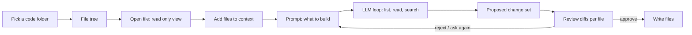

# K0ding

> [!abstract] One-liner
> K0ding opens a code project on your computer (for example, an MCP server you are building). You see the file tree, open files to read them, and type what you want in a prompt box. The LLM reads the code and proposes changes. You see each change as a diff and approve it before any file is written.

> [!important] All four phases are built
> You can open a folder, read files, ask the model, approve each change, run checks, use project guidance and notes, connect an MCP server, and save the work as a skill or workflow draft.

## Why a new module

The Assistant can already read and write files, but only inside the BlackAgents workspace, and the chat does not show the project. K0ding is for **real code projects**: the tree is always visible, you choose which files the LLM sees, and every change is a diff you review.

## What we can reuse

| Need | Already in the code |
|------|---------------------|
| Tool loop with turns, limits, abort | `runAgentLoop` in `lib/runtime/agent-loop.ts` |
| Approve risky actions | `lib/runtime/approvals.ts`, `/api/approvals`, approval cards in chat |
| Read / list / write tools | `lib/runtime/tools/fs.ts` (`fs_list`, `fs_read`, `fs_write`) |
| Run a command (build, tests) | `lib/runtime/tools/shell.ts` (`shell_run`, risk `exec`) |
| Path guard | `resolveInWorkspace`, `checkDirectory`, `walkFiles` in `lib/fs-service.ts` |
| Streaming to the page | `lib/sse.ts`, `lib/sse-client.ts`, chat SSE events |
| Code view | CodeMirror (`@codemirror/view`, `@codemirror/state`) is already installed |
| Model per task | Settings → AI → Models by task (`lib/llm/task-models.ts`) |
| Feature shape | Meetings: `lib/meetings/*`, `app/api/meetings/**`, `components/features/meetings/*` |

## The flow



## Phases

### Phase 1 — See the project (no LLM)

- **K0ding** page (`/k0ding`) and a sidebar item under Meetings (icon `SquareCode`).
- **Open folder**: type or paste a path (the same check as the workspace picker, `checkDirectory`). In the desktop app, a native **Browse** button (new IPC `dialog:openDirectory` in `electron/main.cjs` and `preload.cjs`).
- The folder is saved as a **code root** for the active project, so next time it opens directly. More than one root is allowed; a dropdown switches between them.
- **File tree** on the left. Folders load when you open them (no full scan of big repos). Hidden by default: `.git/`, `node_modules/`, `dist/`, `build/`, `.next/`, `coverage/`, and anything in `.gitignore`. A toggle shows hidden files.
- **File view** in the center: tabs, read only, syntax colors by file type, line numbers. Binary files and files over 1 MB show a short message instead.
- Quick open (`Cmd/Ctrl+P`) by file name, and a search box for text in files.

### Phase 2 — Ask the LLM, review the changes

- **Prompt box** on the right, like the Assistant chat, but scoped to the code root.
- **Context chips** above the box: the open file is added by default; you can add or remove files and folders (right-click in the tree → "Add to context"). The list is shown, so you always know what is sent.
- The LLM runs in `runAgentLoop` with K0ding tools (see below). It can list, read, and search **any** file in the root, not only the chips. Each read shows in the chat as a small line ("Read `src/server.ts`").
- Writes are **staged, not written**. Every `code_write` / `code_edit` call adds the file to a **change set**. The model gets "staged" as the result and goes on.
- When the loop ends, a **Changes** panel lists each file: new, changed, or deleted, with `+/-` line counts. Click a file to see the diff (CodeMirror merge view).
- Per file: **Apply**, **Discard**. For all: **Apply all**, **Discard all**. **Ask for changes** sends your comment back to the LLM with the current change set.
- Before writing, the file is checked again. If it changed on disk after the LLM read it, the file is marked **conflict** and is not written; you can reload and ask again.
- The session (prompt, messages, change set) is saved, so a refresh or a crash does not lose work.

### Phase 3 — Run and check

- **Run a command** from the page or by the LLM (`shell_run` with `cwd` = code root). Always risk `exec`: an approval card shows the exact command each time, unless you allow it for this session. Useful for `npm run build`, `npm test`, `npx tsc --noEmit`.
- After **Apply all**, an optional "check" command (set per code root, for example `npm run type-check`) runs and its output goes back to the LLM if it fails, so it can fix its own errors. Each fix is again a change set you review.
- **Git view**: a badge on changed files in the tree, and the git diff for a file. Read only: no commit, push, or branch from K0ding in this phase.
- **Edit by hand**: a file can be switched to edit mode and saved (same conflict check).

### Phase 4 — Project tools

- **Use my artifacts**: pick an agent, rule, or skill from the workspace to guide the session (for example the `typescript-strict` rule). Rules marked `alwaysApply` and matching `globs` are added by default.
- **Project memory**: a short `.black-agents/k0ding/<root-id>/notes.md` the LLM can read (stack, commands, folder roles). The user edits it; the LLM can only propose changes to it.
- **MCP server helper**: when the root has `@modelcontextprotocol/sdk` in `package.json`, offer "Try this server": add it to `.black-agents/mcp.json` as a stdio server with trust `ask`, then list its tools. This closes the loop: build an MCP server in K0ding, test it in the Assistant.
- Save a useful prompt or session as a **workflow** or **skill** (same path as "Build from this meeting").

## K0ding tools

All tools take a path **relative to the code root**. The root is fixed for the whole session; the model cannot change it.

| Tool | Risk | Does |
|------|------|------|
| `code_list` | read | list a folder (hidden folders skipped unless asked) |
| `code_read` | read | read a file, with optional line range; 100 KB cap, then cut with a note |
| `code_search` | read | search text or regex in files; max 200 matches |
| `code_write` | read* | stage a full new content for a file (create or replace). Max 1 MB per file |
| `code_edit` | read* | stage a replace of an exact text block in a file; fails if the block is not found once |
| `code_delete` | read* | stage a delete |
| `shell_run` | exec | Phase 3 only; `cwd` = code root |

\* Staging has no side effect on disk, so the loop does not ask. The real write happens only when you press **Apply**, through a normal API call, not through the model.

Tools are a new set in `lib/runtime/tools/code.ts`. They do not reuse `fs_*` directly, because `fs_*` are tied to the workspace root and write right away. Shared helpers (read cap, binary check, truncation) move to a small common module.

## Models by task: Coding

A new **Coding** tab in **Settings → AI → Models by task**, like Meeting.

| Picker | Does | When empty |
|--------|------|------------|
| **Code** | Runs the K0ding loop | The Assistant's current model |

- Settings: `models.coding?: { provider, model }`, patch schema with no defaults.
- The page shows which provider gets the code before the first prompt.
- Max turns uses `assistant.maxToolTurns`; K0ding can set its own value later if needed.

## Data and storage

```ts
interface CodeRoot {
  id: string               // slug of the folder name, unique
  path: string             // absolute, real path (symlinks resolved)
  label: string
  checkCommand?: string    // Phase 3
  hidden: string[]         // extra patterns to hide
}

interface CodingSession {
  id: string
  rootId: string
  createdAt: string
  status: "running" | "review" | "applied" | "discarded" | "interrupted" | "failed"
  context: string[]        // relative paths the user pinned
  messages: { role: "user" | "assistant" | "tool"; content: string; at: string }[]
  changes: StagedChange[]
}

interface StagedChange {
  path: string             // relative to the root
  kind: "create" | "update" | "delete"
  baseHash?: string        // sha256 of the file when the LLM read it
  content?: string         // new content (not for delete)
  state: "pending" | "applied" | "discarded" | "conflict"
}
```

- Code roots: `.black-agents/k0ding/roots.json`, or `.black-agents/k0ding/<project-id>/roots.json` when a project is active (same rule as meetings).
- Sessions: `.black-agents/k0ding/sessions/<id>.json` (with the same project subfolder rule). Sessions stay on the K0ding page only. They do not appear in the Assistant history.
- K0ding writes **nothing** inside the code root except applied changes. No config files are added to your repo.
- All JSON and all request bodies are checked with zod.

## API

| Route | Does |
|-------|------|
| `GET/POST /api/k0ding/roots`, `PATCH/DELETE /api/k0ding/roots/[id]` | list, add, edit, remove code roots |
| `GET /api/k0ding/roots/[id]/tree?dir=` | one folder level |
| `GET /api/k0ding/roots/[id]/file?path=` | file content + hash |
| `GET /api/k0ding/roots/[id]/search?q=` | text search |
| `POST /api/k0ding/sessions` | start a session; streams SSE events like `/api/chat` |
| `POST /api/k0ding/sessions/[id]/messages` | follow-up prompt ("Ask for changes") |
| `POST /api/k0ding/sessions/[id]/apply` | apply `{ paths: string[] }`; returns applied and conflict lists |
| `POST /api/k0ding/sessions/[id]/discard` | discard `{ paths }` |

All routes use the standard envelope (`ok` / `fail` / `handle`), return 412 when no workspace is selected, and 404 for an unknown root.

## Safety

- **Path guard**: a new `resolveInRoot(root, rel)` (same logic as `resolveInWorkspace`, with `realpath` so a symlink cannot point outside). Every route and tool uses it.
- **Blocked roots**: `/`, the home folder itself, and system folders cannot be a code root.
- **Never sent to the LLM** by default: `.env*`, `*.pem`, `*.key`, `id_rsa*`, `.npmrc`, files in `.git/`. They show in the tree with a lock icon and open only in the viewer. A per-root setting can allow a file, with a warning.
- **Never written**: `.git/` and anything outside the root.
- File content is **data, not instructions** (same rule as YouTube sources and meeting transcripts), so a comment in the code cannot command the agent.
- Keys stay on the server; nothing is logged with file content.
- Change sets are applied only by the user through `/apply`, never by the model.

## UX

- Three panes, resizable: **tree** (left), **file tabs** (center), **prompt + changes** (right). The right pane can collapse. No page-level scroll.
- All four states: loading, empty (no root yet: "Open a folder to start"), error (with a next step), and success.
- A one-line intro and a "How it works" panel: open folder → read → ask → review → apply.
- A changed-files count badge on the Changes tab. Leaving the page with pending changes asks first.
- Both themes; keyboard: `Cmd/Ctrl+P` quick open, `Cmd/Ctrl+Enter` send, `Esc` stop the loop.

## Tests

- Unit (`lib/k0ding/*`): path guard (`..`, absolute paths, symlinks out), hidden and secret patterns, `code_edit` match rules, change set apply and conflict, store read/write in a temp folder.
- Integration (`app/api/k0ding/**`): roots CRUD, tree and file routes, apply with conflict, 412 / 404 / 400 cases. LLM provider mocked.
- E2E (Playwright): open a temp folder, browse the tree, open a file, run a prompt with a mocked provider, review a diff, apply, see the file changed.

## Decisions

1. **Any folder** can be a code root, saved per project. It does not need to be the BlackAgents workspace.
2. **Review first**: the LLM only stages changes; files are written only after you approve them, per file.
3. The loop is the same `runAgentLoop` as the Assistant, with its own tool set and model picker.
4. Sessions stay on the K0ding page only. They are not part of the Assistant history.
5. A staged file can be up to 1 MB. Bigger files are rejected and the model is told to split the change.
6. No "write directly" mode until Phase 3 is stable. Until then, every write goes through review.

## Related

- [Agent Runtime & Approvals](../architecture/agent-runtime-approvals.md) — the loop, tool risk, and approvals K0ding reuses
- [Workspace & Filesystem Safety](../architecture/workspace-filesystem-safety.md) — the path guard `resolveInRoot` copies
- [Meeting Secretary](./meeting-secretary.md) — the same module shape (lib, API, page, model picker)
- [MCP Servers](../architecture/mcp-servers.md) — where a server built in K0ding is added to test it
- [Future Phases](../roadmap/future-phases.md) — where this sits on the roadmap
