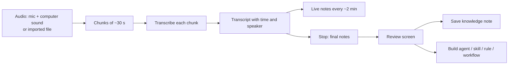

# Meeting Secretary

> [!abstract] One-liner
> BlackAgents acts like a secretary in a call. It listens to Google Meet, Zoom, Skype, Teams, or any other app, writes a transcript, keeps live notes, and at the end proposes a knowledge note. The user can also build an agent, skill, or rule from the meeting. Nothing is saved without review.

> [!important] Plan only
> Nothing here is built yet. Each phase below ships on its own and is useful alone.

## Why listen on the computer, not inside the call app

Each call app has its own API, plan limits, and sign-in, and bots that join a call are hard to build and feel strange to other people. The audio on the user's computer is the same for every app. So the secretary listens to the **microphone** (the user) and the **computer sound** (the other people). This works for any app, with no account to connect.

A second, simpler door: most apps can already export a transcript (Meet on Workspace plans, Zoom cloud recording, Teams). The user can import that file or an audio file instead of recording.

## What we can reuse

| Need | Already in the code |
|------|---------------------|
| Audio to text | `lib/llm/transcribe.ts`, `POST /api/assistant/transcribe` (OpenAI or Custom provider; key stays on the server) |
| WAV encoding | `lib/audio/wav.ts` |
| Transcript as a source | `lib/sources/youtube.ts` pattern; `renderYouTubeSourcesForPrompt` quotes text as data, not instructions |
| Draft an artifact from sources | `POST /api/artifacts/draft-body` with `sources`, plus `ensureSourcesSection` |
| Propose knowledge | `POST /api/knowledge/propose` |
| Model per task | Settings → AI → Models by task (`settings.models`, `lib/llm/task-models.ts`) |
| Desktop shell | `electron/main.cjs`, tray in `electron/tray.cjs` |

## The flow



## Phases

### Phase 1 — Import a meeting (small, no recording)

- **Meetings** page with an **Import** button: paste text, or drop `.txt`, `.md`, `.vtt`, `.srt`, or an audio file (`.m4a`, `.mp3`, `.wav`, `.webm`, `.ogg`). Word `.docx` is not in this phase.
- Audio is decoded in the browser (`AudioContext.decodeAudioData`), cut into 16 kHz mono WAV chunks under the current `MAX_AUDIO_BASE64_LENGTH` (6 MB base64), and sent chunk by chunk to the transcribe route. No ffmpeg, no new native package.
- The model writes **meeting notes**: summary, decisions, action items (who, what, when), open questions, people, and terms.
- Review screen with two actions:
  - **Send to Brain** — queues the note in the Brain inbox (`proposeConcept`, origin `meeting`). Approving it writes the knowledge file. The screen shows the path first. This matches the rule that knowledge is written only after a person approves it.
  - **Build from this meeting** — suggests artifacts (agent, skill, rule) and **workflows**, each with a one-line reason. The user picks. An artifact opens the existing editor pre-filled through `draft-body` with the transcript as a source; a workflow opens the workflow builder with the steps drafted from the action items and the agreed process.

### Phase 2 — Live secretary (desktop app)

- **Start listening** in the Meetings page and in the tray. A clear "Listening" sign stays visible (tray icon + page banner) the whole time.
- Two tracks: mic = **Me**, computer sound = **Others**. This gives a simple speaker split with no extra model.
- Every ~30 s a chunk is transcribed. Every ~2 min the notes update (rolling summary, so the prompt does not grow with the call).
- **Pause**, **Stop**, and **Add a note** (the user types a mark like "important" at this time).
- Stop → final notes → the same review screen as Phase 1.
- If the app or the network fails, chunks already done are kept; the meeting is marked interrupted, like workflow runs.

### Phase 3 — Nice to have

- Real speaker names (a diarization model, or the user names "Speaker 1, 2" once).
- Offer to start when a call app opens (Zoom, Teams, a Meet tab).
- Search across meetings; "What did we decide about X?" in chat.
- Link action items to workflows (for example, create a task).

## Capturing computer sound

> [!warning] macOS needs extra work
> In Electron 43, `setDisplayMediaRequestHandler` with `audio: "loopback"` captures computer sound **on Windows only** (see `node_modules/electron/electron.d.ts`). The microphone works everywhere through `getUserMedia`.

Options for macOS, to test in a short spike before Phase 2:

| Option | Good | Bad |
|--------|------|-----|
| Small Swift helper with ScreenCaptureKit audio (macOS 13+), started by Electron, sends PCM over stdio | No extra install for the user; can capture one app only | Native code to sign and ship; needs Screen Recording permission |
| Core Audio process tap (macOS 14.2+) in the same helper | Audio only, cleaner permission | Newer macOS only |
| Virtual audio device (BlackHole) chosen as an input | No native code for us | User must install and set it up; hard for first-time users |
| Mic only | Works today | Hears the others only through the speakers; bad with headphones |

Plan: build Phase 2 with the mic + Windows loopback first, add the macOS helper after the spike, and show "Others are not heard on this Mac yet" when it is missing.

## Models by task: Meeting

A new **Meeting** card in **Settings → AI → Models by task** lets the user choose the models. It is a special job, like Voice and Video, so it is not a chat `task:<kind>`.

| Picker | Does | When empty |
|--------|------|------------|
| **Listen** | Turns the call audio into text. Saved as `{ provider: "openai" \| "custom", model }` | The Voice model (Custom), or `whisper-1` (OpenAI) |
| **Notes** | Writes notes and suggestions. Saved as `{ provider, model }` | The Assistant's current model |

OpenAI Listen models: `whisper-1`, `gpt-4o-mini-transcribe`, `gpt-4o-transcribe`. An unknown id falls back to `whisper-1`.

- Settings: `models.meeting: { listen?: { provider, model }, notes?: { provider, model } }`, with a patch schema that has no defaults so one picker does not reset the other (same as `jev.cutoffs`).
- Meeting is its own tab on the Models by task card. It is not a chat `task:<kind>`.
- The card says long calls cost more. A per-hour price is shown only when a price table exists for that model.

## Data and storage

```ts
interface Meeting {
  id: string
  title: string
  startedAt: string
  endedAt?: string
  status: "listening" | "paused" | "processing" | "ready" | "interrupted" | "failed"
  source: "live" | "import"
  app?: string                        // "Zoom", "Google Meet", typed or detected
  segments: { at: number; speaker: "me" | "others" | string; text: string }[]
  marks: { at: number; text: string }[]
  notes?: MeetingNotes
}

interface MeetingNotes {
  summary: string
  decisions: string[]
  actionItems: { owner?: string; task: string; due?: string }[]
  openQuestions: string[]
  people: string[]
  suggestions: { kind: "agent" | "skill" | "rule" | "workflow"; name: string; reason: string }[]
}
```

- The meeting keeps the project that was active when it **started** (`scope?: string`, the project id). Switching project during the call does not move it.
- Raw meeting (transcript + notes): `.black-agents/meetings/<id>.json`, or `.black-agents/meetings/<project-id>/<id>.json` when a project was active. Not in `knowledge/` until the user saves a note, so the knowledge base stays clean.
- Saved knowledge note:

| Active project when the meeting started | Note path |
|-----------------------------------------|-----------|
| none | `.black-agents/knowledge/meeting/<date>-<title>.md` |
| `myhealthcare` | `.black-agents/knowledge/meeting/myhealthcare/<date>-<title>.md` |

  `<project-id>` is the project folder name (kebab-case, same as `project.json.id`). Knowledge stays a workspace store (see [Project Scopes](../architecture/project-scopes.md)); the subfolder only groups the notes. The review screen shows the path before saving.
- Artifacts and workflows built from a project meeting are created in that project by default.
- **Audio is not kept** by default. A setting can keep it for a few days.
- All input (imports, model output) is checked with zod. Notes are parsed with the fenced-JSON protocol and the existing retry.

## Privacy and trust

- First time: a short "Before you record" screen. Everyone in the call must agree; some places require it by law.
- The transcript goes to the user's chosen LLM provider. The screen says which one before starting.
- Transcript text is data, not instructions (same rule as YouTube sources), so a person in the call cannot command the agent.
- Keys stay on the server. Nothing is logged with transcript text.
- **Delete meeting** removes the JSON and any kept audio.

## UX (checked against the `ux-review` command)

- All four states on the Meetings page: loading, empty (teaches how to import or start), error (with a next step), and success.
- One-line intro and a "How it works" panel: listen → notes → review → save or build.
- Limits shown: max file size, chunk length, providers that can transcribe (OpenAI or Custom; Anthropic cannot).
- Each action says what it does ("Saves a note in Knowledge → meetings").
- Preview before save; leaving with unsaved review asks first.
- Both themes; no page-level scroll.

## Decisions

1. Models: a new **Meeting** task in Models by task, with **Listen** and **Notes** pickers.
2. Notes path: `knowledge/meeting/`, and `knowledge/meeting/<project-id>/` when a project is active.
3. **Build from this meeting** also proposes workflows.
4. Notes language: the **language of the call**. The Notes model detects it from the transcript and writes the live notes, final notes, and suggestions in it. When a call mixes languages, it uses the one spoken most. Artifacts and workflows built from the meeting follow the normal editor language. The UI labels (Summary, Decisions…) stay in the app language.

## Related

- [YouTube Sources](./youtube-sources.md) — the same "transcript as a source" pattern
- [Assisted Artifact Drafting](./assisted-artifact-drafting.md) — the draft flow "Build from this meeting" reuses
- [LLM Integration](../architecture/llm-integration.md) — providers, transcription, and the fenced-JSON protocol
- [Future Phases](../roadmap/future-phases.md) — where this sits on the roadmap
