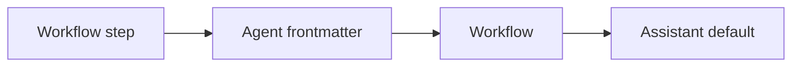

# Model Routing

> [!abstract] One-liner
> Let different agents and workflow steps run on different models. One shared resolver decides which provider + model a call uses, from the most specific setting to the least specific one.

This is the **umbrella spec**. Build the phases in order; each phase has its own spec:

| Phase | Spec | Status |
|-------|------|--------|
| 1 | Models by task — Voice tab | **shipped** ([PR #28](https://github.com/cristoferdomingues/BlackAgents/pull/28)) |
| 2 | [Agent Models](./agent-models.md) — `model:` / `provider:` in agent frontmatter | **shipped** |
| 3 | [Workflow Step Models](./workflow-step-models.md) — per-step override in the builder | **shipped** |
| 4 | [Task Model Kinds](./task-model-kinds.md) — `model: task:vision` etc., set in Settings → AI | **shipped** |

> [!important] Read first
> Before coding, read `AGENTS.md`, `.cursor/rules/*.mdc`, and the skills `nextjs-app-patterns`, `llm-integration`, `testing-patterns`. Next.js here is v16: check `node_modules/next/dist/docs/` before writing route code.

## Today (before phase 2)

| Caller | How the model is picked | File |
|--------|-------------------------|------|
| Assistant chat (with or without an agent persona) | request `provider` + `model` from the header picker, else `provider.models[0]` | `lib/assistant/chat-service.ts` → `prepareChat` |
| Workflow run | one LLM for **every** step: workflow `provider`/`model` → `secrets.defaults` → first verified provider | `lib/workflows/llm.ts` → `resolveRunLlm`; used once in `lib/workflows/executor.ts` → `executeRun` |
| Second Brain learning | `resolveRunLlm` | `lib/brain/learn.ts` |
| Voice (Custom) | `settings.models.voice` → OpenRouter default | `app/api/assistant/transcribe/route.ts`, `lib/llm/task-models.ts` |

Agents have no model. The parser keeps unknown frontmatter keys (`lib/artifacts/parser.ts`), but zod `extra` (`lib/artifacts/schemas.ts`) and the export adapter (`lib/export/adapter.ts`) drop them.

## The precedence rule

The most specific layer that sets a model wins:



- **Chat with an agent:** agent → header picker (the header picker *is* the Assistant default for chat).
- **Workflow step:** step → agent → workflow → `secrets.defaults` → first verified provider.
- Any layer may name a **task kind** (`task:vision`) instead of a model id. The kind is resolved from Settings → AI → Models by task *at that layer* (phase 4). A task kind is a value, not a separate layer.

> [!note] Correction to the earlier roadmap
> [Future Phases](../roadmap/future-phases.md) first listed "task kind" as its own layer between agent and workflow. This spec replaces that: task kind is a value any layer can use.

## Shared types — `lib/llm/model-ref.ts` (new, phase 2)

Phase 2 creates this file. Phases 3 and 4 only extend it.

```ts
import type { ProviderId } from "@/lib/llm/types"
import type { ModelTask } from "@/lib/llm/task-models"

/** What one layer says about the model. */
export type ModelRef =
  | { kind: "inherit" }                                   // not set, or "inherit"
  | { kind: "id"; model: string; provider?: ProviderId }  // a real model id
  | { kind: "task"; task: ModelTask }                     // "task:<kind>" (phase 4)

export type ModelSource = "step" | "agent" | "workflow" | "assistant"

export interface ModelLayer {
  source: ModelSource
  ref: ModelRef
}

/** Parse raw strings (frontmatter / JSON). Unknown task kinds are an error. */
export function parseModelRef(model: unknown, provider: unknown): ModelRef

/** First layer that is not "inherit"; undefined when all inherit. */
export function pickModelLayer(layers: ModelLayer[]): ModelLayer | undefined

export interface ResolvedModelChoice {
  provider: ProviderId
  model: string
  source: ModelSource
  /** Set when the choice came from a task kind. */
  task?: ModelTask
}
```

Rules for `parseModelRef`:

| Raw `model` | Raw `provider` | Result |
|-------------|----------------|--------|
| missing, `""`, `"inherit"` | any | `{ kind: "inherit" }` (a lone `provider` is ignored, with a validation warning) |
| `"task:<kind>"` | must be missing | `{ kind: "task" }`; before phase 4 every kind is unknown → error |
| any other string (≤200 chars, trimmed) | missing or `openai` \| `anthropic` \| `custom` | `{ kind: "id", model, provider? }` |

A model id **without** a provider uses the provider of the next layer down (for chat: the header provider; for a step: the workflow's resolved provider). Slashes are normal in ids (`google/gemini-2.5-flash`) — never split them into provider/model.

The final step (credentials + fallback) stays in `lib/workflows/llm.ts`. Extend `resolveRunLlm` to take `layers: ModelLayer[]` instead of `{ provider?, model? }`, and keep a thin wrapper for the old call sites until they move.

## Errors (all callers)

| Case | Status | Message (exact pattern) |
|------|--------|-------------------------|
| Chosen provider has no verified key | 412 | `Agent "<name>" uses <Provider label>, which is not verified. Verify it under AI Providers.` (say `Step "<id>"` for steps) |
| Unknown task kind / bad provider value in frontmatter | 400 on save; run fails fast | `Unknown model task "<kind>"` / `Unknown provider "<value>"` |
| Task kind has no model set (phase 4) | 412 | `Set the <Label> model in Settings → AI → Models by task` |

Never put API keys in errors or logs.

## Show the user which model ran

- Chat: add `model: { provider, model, source }` to the existing SSE `context` event (`app/api/chat/route.ts`, parsed by `chatContextEventSchema` in `components/features/chat/chat-page.tsx`).
- Workflows: add `provider`, `model`, `modelSource` to `StepRun` (`lib/workflows/schema.ts`) and show them on the run page.

## Out of scope (all phases)

- Picking a model automatically from the message content (e.g. images → vision model). Listed in [Task Model Kinds](./task-model-kinds.md#open-future).
- Per-agent API keys. Keys stay per provider in `~/.black-agents/secrets.json`.
- Cost tracking.

## Related

- [Agent Models](./agent-models.md) · [Workflow Step Models](./workflow-step-models.md) · [Task Model Kinds](./task-model-kinds.md) — the phase specs
- [LLM Integration](../architecture/llm-integration.md) — providers, credentials, voice model
- [Workflows](../architecture/workflows.md) — runner and executor
- [Future Phases](../roadmap/future-phases.md) — roadmap
