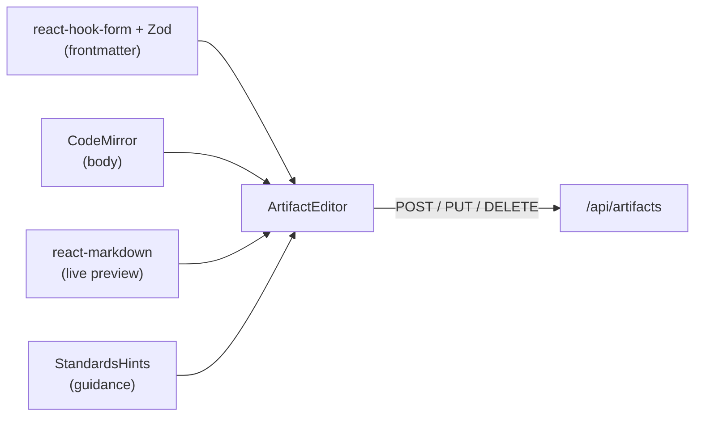

# UI Overview

The UI follows the [BlackLionFi](../overview/tech-stack.md) component conventions: shadcn/ui primitives, feature-first folders, a sidebar + header shell, and a dark-first violet theme.

## Shell (`components/layout/`)

| Component | Role |
|-----------|------|
| `AppSidebar` | Nav to dashboard, assistant, the four type lists, **workflows**, **brain**, graph, standards, export, sync, AI providers, settings; per-type counts + quick-create |
| `AppHeader` | **Workspace switcher** dropdown (pick the active workspace from any page), refresh, global "New" dropdown |
| `ThemeProvider` / `ThemeToggle` | `next-themes` dark/light/system |
| `WorkspaceProvider` | Shares the active workspace + saved list; exposes `addWorkspace`, `setActive`, `removeWorkspace` |

## Feature Areas (`components/features/`)

| Area | Key components |
|------|----------------|
| dashboard | `DashboardPage` — counts, recent artifacts, no-workspace state |
| artifacts | `ArtifactListPage` (TanStack Table), `ArtifactBadges`, `NoWorkspace`; the skills list also shows `SkillSuggestBox` |
| editor | `ArtifactEditor`, `MarkdownEditor`, `MarkdownPreview`, `GlobsInput`, `StandardsHints`, `AgentToolsField` (agent `tools` + `mcpServers`), `YouTubeSourcesField` on a new skill, `SkillTriggerButton` on skills |
| wizard | `Wizard` — Type → Details → Body → Review |
| graph | `GraphView` (react-force-graph-2d) |
| standards | `StandardsPage` — edit/preview/save/reset |
| export | `ExportPage` — target platform, diff preview, write w/ confirm, cross-repo target field, `.zip` download |
| sync | `SyncPage` — per-platform drift report (in-sync / drifted / missing) with links to resolve in Export |
| chat | `ChatPage` — BYO-key assistant over SSE: provider/model/agent pickers, **Allow file writes** switch, paperclip (**Attach files**), YouTube button (**Add a YouTube video**), mic that becomes **Send** when there is text, "Context:" badges, a session usage badge (tokens and cost, with a tooltip), tool traces (`MessageParts`) with **Save as browser flow** when traces include successful `browser` MCP calls, draft cards with **Open in editor**, `BundleCard` (**Create all**), `WorkflowDraftCard` (**Save** / **Open in builder**), `WorkflowRunCard` (**Run**), `FeedbackBar` (👍/👎 + comment) |
| approvals | `ApprovalCard` — shows a waiting `write`/`exec` call: Approve, Deny, "remember this exact call" (exec) |
| workflows | `WorkflowListPage`, `WorkflowBuilder`, `RunView`, `RunStatus`, `PendingApprovalsPanel` — see [Workflows](../architecture/workflows.md) |
| brain | `BrainPage` — Inbox / Memory / Knowledge / History — see [Second Brain](../architecture/second-brain.md) and [Knowledge (OKF)](../architecture/knowledge-okf.md) |
| meetings | `MeetingsPage` — start listening, or import a transcript or audio file, review notes, send them to Brain, or open a draft. See [Meeting Secretary](../specs/meeting-secretary.md) |
| providers | `ProvidersPage` — per-provider API-key management (configured badge + last-4), custom base URL |
| settings | `SettingsPage` — workspaces (add, set-active, remove); **AI** tab (`AiSettingsCard`: max tool turns, Jev, `JevDecisionsCard` levels + recent decisions, task models including **Meeting** Listen and Notes); **MCP** tab (stdio / HTTP / SSE, header list with secret promotion, `McpTrustSelect`); **Browser** tab (`BrowserAutomationCard`: Playwright MCP, record/save, daily bind, **Update flows on heal**, flow secrets — see [Browser Automation](../specs/browser-automation.md)) |

## The Editor

- Frontmatter fields are form-driven and type-aware (`parallel` for agents; `alwaysApply` + `globs` for rules).
- `StandardsHints` reads `STANDARDS_SPEC` and surfaces required sections + anti-patterns for the current type as you type.
- Typing `@` in the body opens a **type-grouped mention autocomplete** to link other artifacts (see below).
- Rename and delete are handled in the editor with confirmation dialogs.

> [!tip] Draft with assistant
> In the **create** flow, once `name` + `description` are valid and an AI provider is configured, a **Draft with assistant** button asks the LLM to write the `body` in place (`POST /api/artifacts/draft-body`) and toasts which existing artifacts it linked. A **new skill** can skip the description when at least one YouTube video is ready: the **YouTube videos** field reads captions, and the draft ends with a `## Sources` section. It reuses the [chat's](../specs/assisted-artifact-drafting.md) last-used provider/model. Full design: [Assisted Artifact Drafting](../specs/assisted-artifact-drafting.md) and [YouTube Sources](../specs/youtube-sources.md).

> [!tip] Check a skill trigger
> On a skill (create or edit), **Check trigger** needs only a name and description. It does not use the chat provider. Jev tries the description and a few unrelated tasks, then shows ready, too wide, may never trigger, or unclear. See [Jev Decision Engine](../architecture/jev-decision-engine.md).

> [!tip] Validate with assistant
> A companion **Validate with assistant** button (`ShieldCheck`) appears in **both create and edit** modes. Once name + description + `body` are filled, it asks the LLM to *review* the artifact against the [Authoring Standards](../artifacts/authoring-standards.md) (`POST /api/artifacts/validate`) and opens an **Assistant review** dialog with a severity-colored findings list. It is **read-only** — nothing is rewritten; the user applies fixes by hand. Because of this, the editor now loads providers in edit mode too. Full design: [Assisted Artifact Drafting](../specs/assisted-artifact-drafting.md).

> [!tip] `@` to link artifacts
> In the body editor, pressing `@` lists every workspace artifact **grouped by type** (Agents / Commands / Rules / Skills), so you never link an agent when you meant a same-named skill. Picking one inserts a `@type:name` token; on save it's rewritten into the [cross-reference convention](../architecture/relationship-graph.md) and the Preview shows the final markdown live. Full design: [Artifact Mentions](../specs/artifact-mentions.md).

## Three Ways to Create

1. **Direct** — sidebar/header → `New <Type>` → the type's `/new` page. With a provider configured, **Draft with assistant** can fill the body from `name` + `description` ([Assisted Artifact Drafting](../specs/assisted-artifact-drafting.md)).
2. **Guided** — `/new` wizard walks Type → Details → Body → Review, reusing the same editor components and standards guidance.
3. **Chat** — describe the artifact in `/chat`; the assistant proposes a draft, and **Open in editor** prefills the `/new` editor (via `sessionStorage`) for review before saving. Ask for a team and it returns a **bundle** (1 agent + ≤ 3 skills + ≤ 3 rules); **Create all** saves them after a standards check. Ask for a workflow and it returns a **workflow** card. Type `/<workflow> input` or `start @<workflow> input` to open a run card instead of calling the model.

The composer has **Attach files** and **Add a YouTube video** on the left (text, image, PDF, or a caption transcript; paste works for files) and one button on the right: a microphone when the field is empty, **Send** when there is text or a file. Voice fills the field; it does not send by itself. A video with no captions offers **Paste the transcript**. See [LLM Integration](../architecture/llm-integration.md), [YouTube Sources](../specs/youtube-sources.md), and [Workflows](../architecture/workflows.md).

Agents have a **Model** section in the editor: Inherit, OpenAI, Anthropic, Custom, or a task kind (Vision / Fast / Reasoning). When an agent owns the model, `/chat` locks the header model field and shows which model and source really ran.

> [!note] Chat writes only with your OK
> Drafts and bundles are saved only when you click. During a turn, tool writes and commands show an **approval card** first ([Agent Runtime & Approvals](../architecture/agent-runtime-approvals.md)). The **Allow file writes** switch auto-approves writes for one message; commands still ask.

## Workflows & Brain Pages

| Route | Page |
|-------|------|
| `/workflows` | list + waiting approvals |
| `/workflows/new`, `/workflows/[name]` | builder + per-step model/task overrides + run history |
| `/workflows/runs/[id]` | Steps tab (live turn, current action, stuck warning, SSE) and Timeline tab (audit log, filters, export) |
| `/brain` | proposal inbox, memory notes, OKF preview, history |

Settings → AI has **Models by task** tabs for Voice, Vision, Fast, and Reasoning. Chat tasks select a verified provider and model and show the agents/workflow steps that use the task kind.

## Theme Tokens

`tailwind.config.ts` + `globals.css` define a violet primary and per-type accents (`--type-agent`, `--type-command`, `--type-rule`, `--type-skill`) reused by badges, list icons, and graph nodes for a consistent visual grammar.

## Related

- [Authoring Standards](../artifacts/authoring-standards.md)
- [YouTube Sources](../specs/youtube-sources.md)
- [Artifact Mentions](../specs/artifact-mentions.md)
- [Browser Automation](../specs/browser-automation.md) · [MCP Servers](../architecture/mcp-servers.md)
- [Relationship Graph](../architecture/relationship-graph.md)
- [Tech Stack](../overview/tech-stack.md)
- [API Reference](../api/api-reference.md)
- [Workflows](../architecture/workflows.md) · [Second Brain](../architecture/second-brain.md) · [Agent Runtime & Approvals](../architecture/agent-runtime-approvals.md)
